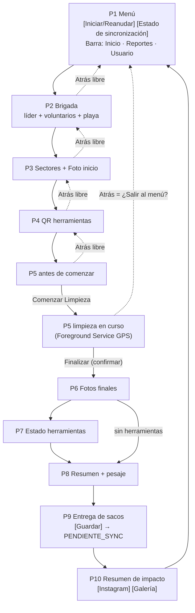
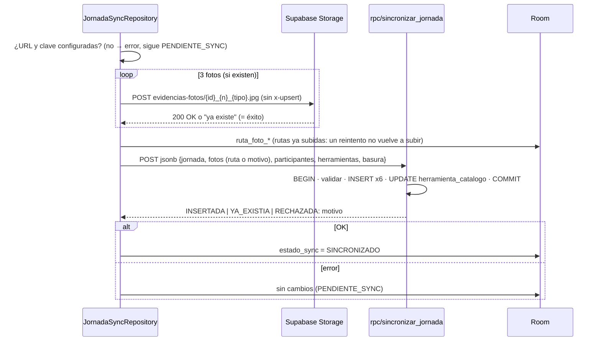

# Arquitectura Técnica: App Móvil "Deja tu Playa Limpia" (10 Pantallas)

> Documento **derivado** de `PRD.md` v3.0. Ante cualquier diferencia prevalece el PRD. Los elementos marcados **(v3)** todavía no están implementados; su issue se indica entre corchetes.

## 1. Stack Tecnológico ($0 Costo Operativo)

| Capa | Tecnología | Rol |
| :--- | :--- | :--- |
| **UI** | Kotlin + Jetpack Compose (Material 3) + Navigation Compose | 10 pantallas, navegación lineal protegida, botonera de conteo. |
| **Persistencia local** | Room (SQLite) + KSP | Fuente única de verdad en terreno: catálogos semilla, jornada en curso (`pantalla_actual`), jornadas pendientes. |
| **Red** | `ConnectivityManager.NetworkCallback` | `Flow<Boolean>` de internet validado para el botón tricolor. |
| **Cámara / QR** | CameraX + ML Kit Barcode (offline) + `TakePicture` vía `FileProvider` | QR de herramientas (P4) y 3 fotos de 1280×720 (P3, P6). |
| **GPS** | FusedLocationProvider dentro de un **Foreground Service** | `km_recorridos` con la pantalla apagada (P5). |
| **Sincronización** | Retrofit 2 + OkHttp 4 + Gson | Fotos → Supabase Storage; datos → **RPC `sincronizar_jornada`** (v3) [ISSUE-21]. |
| **Backend** | Supabase: PostgreSQL con RLS, función RPC `SECURITY DEFINER`, Storage | Catálogos maestros, registro inmutable de jornadas, evidencias. |
| **Reportería** | Google Apps Script en Google Sheets | Lee las vistas con clave secreta; *keep-alive* diario. |
| **Compartir** | Bitmap 1080×1920 + `FileProvider` + Intents de Instagram (v3) [ISSUE-26] | Resumen de impacto (P10). |

## 2. Estructura del Código

```
app/src/main/java/cl/logisticaverde/app/
├─ LogisticaVerdeApp.kt            # Application: instancia DB y JornadaSyncRepository
├─ MainActivity.kt                 # Scaffold + LogisticaVerdeNavHost
├─ data/
│  ├─ local/
│  │  ├─ db/  LogisticaVerdeDatabase, CatalogoDao, JornadaDao, CatalogoSeedData
│  │  └─ entity/  Sector/Herramienta/TipoBasura Catalogo, Jornada, HerramientaJornada,
│  │              BasuraRecolectada, ParticipanteJornada  ── sin UsuarioEntity
│  ├─ remote/  SupabaseApi (Retrofit), SupabaseClient (OkHttp + apikey)
│  └─ repository/  JornadaSyncRepository (orquesta fotos + RPC + catálogos)
├─ domain/util/  NetworkMonitor, ImageCompressor, GpsDistanceTracker,
│                ResumenImpactoCalculator (v3)
├─ service/  LimpiezaLocationService
└─ ui/
   ├─ navigation/NavGraph.kt       # AppDestinations + reglas de back stack
   ├─ screens/menu/                # P1: MenuPrincipalScreen + MenuPrincipalViewModel
   ├─ screens/flujo/               # P2–P9 + JornadaFlujoViewModel (compartido)
   ├─ screens/resumen/             # P10: ResumenImpactoScreen + ResumenImpactoGenerator (v3)
   └─ theme/
```

* **Patrón:** MVVM + Repository. Room es la fuente única de verdad; los ViewModels exponen `StateFlow` y escriben en Room en cada acción (RNF-01).
* **ViewModels:** `MenuPrincipalViewModel` (P1, botón tricolor) y `JornadaFlujoViewModel`, compartido por P2–P9 y con alcance al `NavHost`.
* **Inyección:** manual mediante `ViewModelProvider.Factory` y `LogisticaVerdeApp` (sin Hilt, para mantener el proyecto simple).

## 3. Flujo de Pantallas y Navegación



* `AppDestinations.routeForScreenNumber(pantalla_actual)` permite reanudar en la pantalla exacta.
* Desde P5 iniciada, la navegación hacia adelante usa `popUpTo(PANTALLA_1_MENU)`, de modo que solo queda el menú debajo; un `BackHandler` muestra el diálogo de salida (v3) [ISSUE-22].

## 4. Persistencia Local (Room v5)

* Modelo completo en **PRD §4**. Tablas: 4 catálogos (`playa_catalogo`, `sector_catalogo`, `herramienta_catalogo`, `tipo_basura_catalogo`) + `jornada`, `participante_jornada`, `herramienta_jornada`, `basura_recolectada`.
* Topes compartidos con la RPC en `domain/reglas/TopesJornada.kt`; `FechaJornada` calcula `fecha_jornada` en hora de Chile. Los DAOs limitan el conteo (≤ 5.000) y los km (≤ 30) directamente en SQL.
* `estado_sync`: `EN_CURSO` → (P9 Guardar, tras `ValidadorJornada`) `PENDIENTE_SYNC` → (RPC OK) `SINCRONIZADO`, o (rechazo / foto faltante) `ERROR_SYNC` + `motivo_error_sync` → (Reintentar) `SINCRONIZADO` o `PENDIENTE_SYNC` sin internet.
* v4 → v5 destructiva (31-10-2026, ISSUE-42). Desde la v5, solo migraciones explícitas.
* Semilla: `RoomDatabase.Callback` + verificación en el primer arranque cargan playas, sectores, herramientas y tipos de basura desde `CatalogoSeedData`.
* **Migraciones:** `exportSchema = true`, esquemas en `app/schemas/`; `fallbackToDestructiveMigrationFrom(1, 2, 3)`: los saltos a v3 y a v4 borraron datos de prueba. Desde la v4, `Migration` explícita + `MigrationTestHelper` [ISSUE-17, ISSUE-31].

## 5. Sincronización

### 5.1 Botón tricolor (P1)

```kotlin
val syncButtonState = combine(
    jornadaDao.observePendingSyncCount(), // COUNT(*) WHERE estado_sync = 'PENDIENTE_SYNC'
    networkMonitor.isOnline,              // NET_CAPABILITY_INTERNET + VALIDATED
    _isSyncing
) { pending, online, syncing ->
    when {
        syncing -> SINCRONIZANDO
        pending == 0 -> GRIS_SIN_DATOS
        !online -> AMARILLO_SIN_INTERNET
        else -> VERDE_LISTO_PARA_SYNC
    }
}
```

### 5.2 Secuencia por jornada (v3) [ISSUE-21]



### 5.3 Catálogos
* `GET rest/v1/{sector_catalogo|herramienta_catalogo|tipo_basura_catalogo}` → `@Upsert` en Room.
* Antes del upsert de herramientas se excluyen las que aparecen en jornadas `EN_CURSO` o `PENDIENTE_SYNC` (BR-10).

### 5.4 Manejo de errores [ISSUE-42]
* `domain/sync/ErrorSync.kt`: `SinConfiguracion`, `SinConexion` (IOException), `ServidorNoPreparado` (PGRST202/205, 404), `NoAutorizado` (401/403), `ErrorServidor` (5xx), `Rechazada(motivo)` (RPC `RECHAZADA: …` o 400 22xxx/23xxx), `FotoFaltante`, `Desconocido`. `MensajesSync` da el texto para el líder; `RegistroErrores` escribe en `Log` (sin nombres ni coordenadas).
* `detenerLote` (sin internet, servidor, permisos) corta el lote; `rechazaJornada` deja la jornada en `ERROR_SYNC`; el resto queda `PENDIENTE_SYNC`. `CancellationException` siempre se propaga.
* RPC: `sincronizar_jornada` (pública) envuelve a `sincronizar_jornada_interna`; los errores de clase 22/23 se registran en `jornada_rechazada` (deduplicado por id + motivo, tope 1.000 sin resolver, payload ≤ 20 kB — ISSUE-60) y se responden como `RECHAZADA: <motivo>` (HTTP 200). Si después entra, la fila queda `resuelta`.
* P1: "Servidor en mantención" (revisión al volver al menú, ≤ 1 cada 30 s, y al recuperar internet); error ~4 s en la línea de estado; "N jornada(s) rechazada(s) · revisar en Reportes" y globo rojo en Reportes.
* P2–P9: `CoroutineExceptionHandler` en `JornadaFlujoViewModel` → snackbar "No se pudo guardar. Intenta de nuevo." (la navegación de esa acción no ocurre). P9 valida con `ValidadorJornada` (mismas reglas que la RPC) antes de cerrar.
* Servicio GPS, P10 y escáner QR: errores registrados sin cerrar la app.

## 6. Seguridad

| Elemento | Decisión |
| :--- | :--- |
| Clave en el APK | Clave **pública** (`sb_publishable_…`), inyectada vía `BuildConfig` desde `local.properties`. Solo permite leer catálogos, ejecutar la RPC y subir fotos nuevas. |
| Tablas | RLS en todas; sin políticas de escritura para `anon`. |
| RPC | `SECURITY DEFINER`, `SET search_path = public`, validación de entrada, inserción única por `id_registro`. |
| Vistas | `REVOKE SELECT` a `anon` y `authenticated` (en Postgres las vistas se ejecutan con permisos del dueño y se saltarían el RLS). |
| Storage | Bucket público de lectura; `anon` solo `INSERT` (sin `UPDATE`/`DELETE`). |
| Sheets | Clave secreta en *Script Properties*, nunca en el APK ni en git. |
| Build | El *release* falla si faltan `SUPABASE_URL` o la clave pública; el *logging* HTTP solo en debug. |
| Datos personales | Solo nombres de pila / nombres declarados; no legibles con la clave pública; la tarjeta de Instagram no muestra nombres; las fotos no muestran rostros. |

## 7. GPS — `LimpiezaLocationService`

* `foregroundServiceType="location"`, notificación persistente con los km actuales.
* `LocationRequest`: `PRIORITY_BALANCED_POWER_ACCURACY`, intervalo de 15 s, mínimo de 8 s, `minUpdateDistance` de 6 m.
* Filtro: precisión ≤ 35 m; delta entre 5 y 500 m (reutiliza la lógica de `GpsDistanceTracker`).
* Escribe en Room (`updateKmRecorridos`, coordenada inicial); la UI observa la jornada.
* Ciclo de vida: `startForegroundService` al comenzar; `stopSelf` al finalizar; reinicio al reanudar P5 con la limpieza iniciada.

## 8. Resumen de Impacto (v4) [ISSUE-24..26]

* `domain/resumen/ResumenImpacto.kt`: `ResumenImpactoCalculator` (Kotlin puro, testeable) → `ResumenImpacto` (kg, % reciclable, personas, m², km, duración, top 3) y `FormatoResumen` (formatos es-CL).
* `ResumenImpactoViewModel` carga la jornada por `idRegistro` (ruta `pantalla_10_resumen/{idRegistro}`). La vista previa es el mismo bitmap que se comparte.
* `ResumenImpactoGenerator` dibuja la tarjeta de 1080×1920 (solo cifras, sin fotos) sobre un `Canvas` y la guarda en `cacheDir/compartir/` (única carpeta nueva expuesta por el FileProvider).
* `CompartirResumen`: `ACTION_SEND` dirigido a `com.instagram.android` → selector estándar si no está instalado. Guardado en galería con `MediaStore` (Android 10+) o archivo + `MediaScannerConnection` con `WRITE_EXTERNAL_STORAGE` (`maxSdkVersion=28`) en Android 8–9.
* Pestaña **Reportes** (`ReportesScreen` / `ReportesViewModel`): `JornadaDao.observeUltimasJornadasCerradas(5)`.

## 9. Configuración de Build

| Variable (`local.properties`) | Uso | Obligatoria |
| :--- | :--- | :--- |
| `SUPABASE_URL` | Base URL de Retrofit | Sí en release |
| `SUPABASE_PUBLISHABLE_KEY` | Encabezado `apikey` | Sí en release |
| `META_APP_ID` | Compartir directo a Historias (no implementado por ahora) | No |

`minSdk 26`, `targetSdk 35`, Java/JVM 17, AGP 8.7.2, Kotlin 2.0.21.
