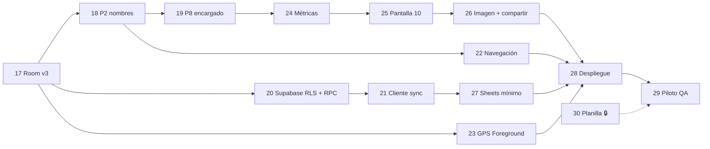

# Backlog de Desarrollo e Issues Técnicos (`ISSUES.md`)

**Fuente oficial del backlog** del sistema **"Deja tu Playa Limpia" (Logística Verde)**, alineado con **PRD.md v4.0** (10 pantallas, Room v4, Supabase v4 con RLS + RPC).

- **Fase v2 (ISSUE-01 a 15):** ✅ completada. Se resume abajo; las partes reemplazadas por la v3 están marcadas con ⚠️.
- **Fase v3 (ISSUE-16 a 30):** en curso. Incorpora el `plan_de_trabajo.md` de la clienta y la revisión técnica del 29-10-2026.
- **Cambios v4 (ISSUE-31 a 36):** ✅ implementados el 31-10-2026 (falta ejecutar el SQL en Supabase).

**Hitos:** pruebas offline del 2 al 6 de noviembre · capacitación del 9 al 13 de noviembre · **piloto del 16 al 20 de noviembre de 2026**.

---

## ✅ Fase v2 — Completada

| Issue | Título | Estado |
| :--- | :--- | :--- |
| ISSUE-01 | Proyecto Android (Kotlin, Compose, Room, Retrofit, CameraX, ML Kit, Location, FileProvider) | ✅ |
| ISSUE-02 | Entidades de catálogo en Room + `supabase_schema.sql` | ✅ ⚠️ `UsuarioEntity` se elimina en ISSUE-17 |
| ISSUE-03 | Entidades operativas (`jornada`, `herramienta_jornada`, `basura_recolectada`) y DAOs | ✅ ⚠️ `id_usuario` se elimina en ISSUE-17 |
| ISSUE-04 | `NetworkMonitor` e `ImageCompressor` (720p) | ✅ |
| ISSUE-05 | P1: menú y botón Sincronizar tricolor | ✅ + "Ver últimos resúmenes" (ISSUE-25) |
| ISSUE-06 | P2: líder y voluntarios desde catálogo | ✅ ⚠️ se reemplaza por nombres escritos a mano en ISSUE-18 |
| ISSUE-07 | P3: sectores (m²) y foto de inicio (con omitir) | ✅ ⚠️ guardar IDs de sectores en ISSUE-17 |
| ISSUE-08 | P4: escaneo QR + selector de respaldo | ✅ |
| ISSUE-09 | P5: comenzar/finalizar, GPS y botonera | ✅ ⚠️ GPS pasa a Foreground Service en ISSUE-23 |
| ISSUE-10 | P6: fotos limpio y sacos (con omitir) | ✅ |
| ISSUE-11 | P7: estado final de herramientas | ✅ |
| ISSUE-12 | P8: resumen y pesaje (Ley 20.949, 25 kg) | ✅ ⚠️ encargado desde participantes en ISSUE-19 |
| ISSUE-13 | P9: entrega de sacos y guardar | ✅ + navega a P10 (ISSUE-25) |
| ISSUE-14 | Cliente Retrofit para Supabase (REST por tabla) | ✅ ⚠️ se reemplaza por RPC en ISSUE-21 |
| ISSUE-15 | Conector Supabase → Google Sheets + keep-alive | ✅ ⚠️ clave secreta y nuevas columnas en ISSUE-27 |

---

## 📚 Épica 5: Documentación v3

### `[ISSUE-16]` Unificar documentación y declarar fuentes oficiales ✅
* [x] Eliminar el PRD de 8 pantallas (PDF, 2 copias) y el entregable académico `.docx`.
* [x] Declarar `PRD.md` e `ISSUES.md` como fuentes oficiales (PRD §0).
* [x] Reescribir `PRD.md` (v3, 10 pantallas, participantes, RLS/RPC, P10).
* [x] Reescribir `ARCHITECTURE.md` y `GLOSSARY.md` alineados al PRD v3.
* [x] Reescribir `ISSUES.md` (este archivo).

---

## 💾 Épica 6: Participantes por Jornada (sin tabla `usuario`)

### `[ISSUE-17]` Modelo de datos Room v3 y política de migraciones · 0,5 d ✅
* **Descripción:** eliminar el padrón de usuarios y registrar los integrantes dentro de cada jornada (PRD §4, RNF-06).
* **Criterios de aceptación:**
  - [x] Eliminar `UsuarioEntity`, sus consultas en `CatalogoDao` y su semilla en `CatalogoSeedData`.
  - [x] Crear `ParticipanteJornadaEntity` (`participante_jornada`): `id` PK auto, `id_registro` FK → jornada (`CASCADE`), `nombre`, `rol` (`LIDER` | `VOLUNTARIO`), índice único `(id_registro, nombre_normalizado)`.
  - [x] `JornadaEntity`: quitar `id_usuario`, su FK y su índice; agregar `total_participantes: Int` y `sectores_ids_csv: String`.
  - [x] DAO: `observeParticipantes(idRegistro)`, `insertParticipante`, `deleteParticipante`, `getParticipantesList`.
  - [x] `LogisticaVerdeDatabase` versión 3 con `exportSchema = true` y carpeta `app/schemas/` configurada en KSP (`room.schemaLocation`).
  - [x] Migración 2 → 3 destructiva **solo para ese salto** (`fallbackToDestructiveMigrationFrom(2)`); quitar `fallbackToDestructiveMigration()` general.
  - [x] Documentar en el código que cualquier versión futura requiere `Migration` explícita + test con `MigrationTestHelper`.
  - [x] ~~Sincronizar las jornadas pendientes antes de instalar la v3~~ — descartado (29-10-2026): los datos locales de prueba no importan.
* **Notas de cierre (29-10-2026):** esquema exportado en `app/schemas/.../3.json`; `room-testing` agregado para `MigrationTestHelper`. Para compilar sin `UsuarioEntity` se adelantó parte de ISSUE-18 y 19 (ver ⏩). La sincronización ya no envía `id_usuario`, así que contra el esquema actual de Supabase fallará hasta ISSUE-20/21.

### `[ISSUE-18]` Pantalla 2: formulario de líder y voluntarios escritos a mano · 1 d ✅
* **Descripción:** RF-P2 y BR-01/BR-02.
* **Criterios de aceptación:**
  - [x] Card 1: campo nombre del líder (≥ 3 caracteres) + selector Cuadrilla A–D.
  - [x] Card 2: campo + `[ + Agregar ]`, lista con eliminar y contador "N voluntarios + 1 líder = N+1 integrantes".
  - [x] Rechazar vacíos y duplicados (normalizando mayúsculas y espacios, incluyendo el nombre del líder) con mensaje bajo el campo.
  - [x] Crear la jornada en Room al agregar el primer participante y persistir cada alta o baja de inmediato (RNF-01).
  - [x] Mantener `nombre_lider`, `voluntarios_csv` y `total_participantes` sincronizados con `participante_jornada`.
  - [x] `JornadaFlujoViewModel`: reemplazar `selectLider` / `toggleVoluntario` por `onNombreLiderChange`, `agregarVoluntario`, `eliminarVoluntario`; quitar `lideresActivos`, `voluntariosActivos`, `usuariosActivos`.
  - [x] La reanudación reconstruye los participantes desde `participante_jornada` y los sectores desde `sectores_ids_csv` (no por nombre).
  - [x] Tests: regla de Pantalla 2, fakes, casos de duplicado y reanudación. Incluye persistencia inmediata, mensajes y contador.

### `[ISSUE-19]` Pantalla 8: encargado de pesaje desde los participantes · 0,25 d ✅
* **Criterios de aceptación:**
  - [x] El desplegable lista los participantes de la jornada + "Otra persona (escribir nombre)" con campo de texto.
  - [x] Se mantiene la validación BR-06 (encargado obligatorio, ≤ 25 kg/saco).
  - [x] Test de la regla con encargado externo (incluye reanudación).

---

## 🔐 Épica 7: Seguridad y Sincronización Robusta

### `[ISSUE-20]` Supabase esquema v3: RLS, RPC `sincronizar_jornada`, bucket solo-INSERT y vistas · 1 d ✅
* **Descripción:** PRD §5.2, §5.3 y §5.5. Actualizar `docs/supabase_schema.sql` para que sea re-ejecutable.
* **Criterios de aceptación:**
  - [x] `DROP TABLE usuario`; quitar `id_usuario` de `jornada`; agregar `total_participantes`, `sectores_ids` (`text[]` o CSV) y crear `participante_jornada` con `UNIQUE (id_registro, lower(trim(nombre)))`.
  - [x] `ALTER TABLE … ENABLE ROW LEVEL SECURITY` en **todas** las tablas de `public`.
  - [x] Políticas: `anon` solo `SELECT` en los 3 catálogos; ningún acceso directo a tablas de jornada.
  - [x] Función `public.sincronizar_jornada(p jsonb) RETURNS text` `SECURITY DEFINER` con `SET search_path = public`: transacción única, validaciones (PRD §5.2), inserta todas las tablas, actualiza `herramienta_catalogo.estado`, devuelve `INSERTADA` o `YA_EXISTIA` (sin modificar si ya existe).
  - [x] `REVOKE ALL ON FUNCTION … FROM public; GRANT EXECUTE … TO anon`.
  - [x] `vista_reporte_jornadas` actualizada (columna `total_participantes` en lugar de `id_usuario`, participantes agregados) y `REVOKE SELECT … FROM anon, authenticated`.
  - [x] Nueva `vista_densidad_diaria`: por fecha local (`America/Santiago`), área con sectores sin repetir, kg del día y densidad; revocada para `anon`.
  - [x] Storage `evidencias-fotos`: público para lectura, política `INSERT` para `anon`; **eliminar** las políticas de `UPDATE` (y no crear `DELETE`).
  - [x] Verificación manual con la clave pública (07-11-2026): `SELECT` a `jornada` y a `jornada_rechazada` → denegado (401); `PATCH` a `herramienta_catalogo` → denegado (401); listar el bucket → vacío; RPC con payload válido → `INSERTADA` (sincronización real desde la app). *Sin probar a mano: subir dos veces la misma foto (paso 5 de la sección 8).*
* **Notas de cierre (29-10-2026):**
  - Probado en Postgres 15 local (Docker) con roles `anon`/`authenticated`/`service_role` y `storage` simulados: migración desde v2 sin perder jornadas, re-ejecución sin errores, `anon` denegado en tablas de jornada, vistas y `UPDATE` de inventario; RPC `INSERTADA` → `YA_EXISTIA`; 9 payloads inválidos rechazados sin dejar filas; densidad del día sin repetir sectores.
  - Extras: el servidor recalcula `nombre_lider`, `voluntarios_csv`, `total_participantes`, `sectores_csv`, `area_total_m2` y `kg_totales`; las URLs de fotos deben ser de este bucket y de esta jornada; una jornada antigua sincronizada tarde no pisa el estado de una herramienta usada después; el bucket acepta solo JPEG ≤ 5 MB con el nombre `REG-…_{1|2|3}_{inicio|limpio|sacos}.jpg` y `anon` no puede listarlo.
  - Contrato del payload en el encabezado de la sección 4 del SQL y ejemplo en `docs/rpc_ejemplo.json`. Todos los errores de validación responden HTTP 400.
  - ✅ (07-11-2026) Esquema v4 ejecutado en Supabase y verificado (ver ISSUE-31 y ISSUE-42).

### `[ISSUE-21]` Cliente de sincronización: RPC, fotos idempotentes y "sin clave = error" · 1 d ✅
* **Descripción:** PRD §5.1, §5.4, BR-09, BR-10, RNF-05.
* **Criterios de aceptación:**
  - [x] `SupabaseApi`: quitar `getUsuarios`, `upsertJornada`, `upsertHerramientasJornada`, `patchEstadoHerramientaCatalogo`, `upsertBasuraRecolectada`; agregar `POST rest/v1/rpc/sincronizar_jornada` con un DTO único (cabecera + participantes + herramientas + basura + URLs).
  - [x] Subida de fotos **sin** `x-upsert`; la respuesta "ya existe" (409 / `Duplicate`) se trata como éxito.
  - [x] **Eliminar el "modo local"** de `JornadaSyncRepository`: si `isCloudConfigured()` es falso, devolver error y dejar todo en `PENDIENTE_SYNC`.
  - [x] `app/build.gradle.kts`: la tarea de build *release* falla si faltan `SUPABASE_URL` o `SUPABASE_PUBLISHABLE_KEY`.
  - [x] `HttpLoggingInterceptor` solo en `BuildConfig.DEBUG`.
  - [x] `sincronizarCatalogosMaestros`: no sobrescribir el `estado` de herramientas presentes en jornadas `EN_CURSO` o `PENDIENTE_SYNC` (BR-10).
  - [x] Tests (`JornadaSyncRepositoryTest`): sin clave → 0 sincronizadas y la jornada sigue `PENDIENTE_SYNC`; falla de la RPC → `PENDIENTE_SYNC`; foto duplicada → éxito; `YA_EXISTIA` → `SINCRONIZADO`; el catálogo no pisa herramientas pendientes.
* **Notas de cierre (29-10-2026):**
  - La RPC recibe solo datos de origen; el servidor recalcula los derivados (ver ISSUE-20). Las URLs de fotos se guardan en Room apenas se suben, así un reintento tras un fallo de la RPC no vuelve a subirlas.
  - Si la RPC rechaza la jornada (HTTP 400), el mensaje de validación del servidor llega al usuario (ej. "Promedio por saco supera 25 kg").
  - 9 tests en `JornadaSyncRepositoryTest`, incluido el contrato JSON (`{"p": {"jornada": …}}`) contra los nombres del SQL.
  - Verificado que `preReleaseBuild` pasa con claves configuradas; el caso sin claves no se probó para no tocar `local.properties`.
  - ✅ Prueba real (07-11-2026): jornada sincronizada desde el emulador contra Supabase y guardada en `jornada`.

### `[ISSUE-22]` Navegación protegida y numeración "Pantalla N de 10" · 0,5 d ✅
* **Descripción:** RF-NAV-1 a RF-NAV-5, BR-11.
* **Criterios de aceptación:**
  - [x] Atrás libre en P2–P4 y en P5 antes de comenzar.
  - [x] Desde `Comenzar Limpieza` hasta P9: `BackHandler` con diálogo "¿Salir al menú? La jornada queda guardada" (`SalirAlMenuBackHandler`).
  - [x] Navegación hacia adelante con `popUpTo` para no acumular pantallas ni permitir reabrir P5 después de finalizada. Además `finalizarLimpieza` ignora un segundo cierre.
  - [x] Títulos "Pantalla N de 10" en todas las pantallas (P1–P9; P10 se titula al crearla en ISSUE-25).
  - [x] Test: un segundo `finalizarLimpieza` no cambia `hora_fin_ms` ni vuelve a navegar. *(Falta prueba manual en teléfono.)*

### `[ISSUE-23]` GPS en Foreground Service · 1 d ✅ (falta prueba en terreno)
* **Descripción:** RF-P5 y RNF-02.
* **Criterios de aceptación:**
  - [x] `LimpiezaLocationService` con `foregroundServiceType="location"` y notificación fija "Limpieza en curso · X,XX km" (canal propio).
  - [x] Manifest: `FOREGROUND_SERVICE`, `FOREGROUND_SERVICE_LOCATION`, `POST_NOTIFICATIONS`; solicitud de permiso de notificaciones en Android 13+.
  - [x] El servicio escribe `km_recorridos` y la coordenada inicial directamente en Room (no depende del ViewModel).
  - [x] Se inicia con `Comenzar Limpieza`, se detiene con `Finalizar Limpieza`, y se reanuda conservando los km si la app se reinicia con la limpieza iniciada.
  - [x] Se conserva el filtro anti-rebote actual (> 5 m, precisión ≤ 35 m, ≤ 500 m).
  - [ ] ⏭️ Prueba en dispositivo: 30 minutos caminando con la pantalla apagada registran una distancia coherente.
* **Notas de cierre (29-10-2026):**
  - `service/LimpiezaLocationService.kt` reutiliza `GpsDistanceTracker`; P5 solo lo inicia/detiene y el ViewModel observa `km_recorridos` en Room.
  - En Room, `updateKmRecorridos` ignora jornadas con `hora_fin_ms > 0` y la coordenada inicial solo se escribe si está vacía: una lectura tardía no altera una limpieza cerrada.
  - Si se sale al menú durante la limpieza, el GPS sigue midiendo (la limpieza continúa) y la notificación lleva de vuelta a la app.
  - Si se niega la ubicación, la limpieza comienza igual pero sin km (comportamiento previo). Si se niegan las notificaciones, el servicio funciona pero la notificación no se ve.
  - Tests: los km escritos por el servicio llegan a la UI y se conservan al finalizar; la coordenada inicial no se pisa.

---

## 🏖️ Épica 7b: Cambios v4 de la clienta (31-10-2026) — antes de la Pantalla 10

> Decisiones tomadas en la ronda de preguntas del 31-10-2026. Room y Supabase se **destruyen y se vuelven a crear** (los datos actuales son de prueba).

### `[ISSUE-31]` Modelo v4: playas, brigada, fecha, sin herramientas, motivos y topes · 1 d ✅
* **Criterios de aceptación:**
  - [x] Room v4 (destructiva desde 1–3): nueva `playa_catalogo` (`id_playa`, `nombre_playa`); `sector_catalogo.id_playa`.
  - [x] `jornada`: `cuadrilla` → `brigada`; nuevas `id_playa`, `nombre_playa`, `fecha_jornada` (AAAA-MM-DD, hora de Chile, se fija al crear la jornada en P2), `sin_herramientas`, `motivo_omision_inicio|limpio|sacos`.
  - [x] Supabase v4: `docs/supabase_reset_v4.sql` (borra todo, incluidas las vistas) + `supabase_schema.sql` recreado; **sin vistas** por ahora.
  - [x] RPC: valida playa y que los sectores sean de esa playa; recalcula `nombre_playa`; `fecha_jornada` entre hoy−60 días y hoy+1 (Chile); hora de inicio no futura.
  - [x] Topes en app y servidor: participantes ≤ 60, cantidad por residuo ≤ 5.000, sacos ≤ 100, kg totales ≤ 2.500, km ≤ 30, duración ≤ 12 h.
* **Notas de cierre (31-10-2026):**
  - Para que una jornada nunca quede bloqueada por un tope que el usuario no controla, la app **limita** en vez de rechazar: el GPS no acumula más de 30 km y, si se finaliza después de 12 h, la hora de fin queda en inicio + 12 h. Los demás topes (participantes, sacos, kg, conteo) se validan en pantalla.
  - SQL probado en Postgres 15 local (Docker) con roles `anon`/`authenticated`/`service_role` simulados: reset + esquema dos veces y re-ejecución del esquema sin errores; 27 casos (válida → `INSERTADA`, repetida → `YA_EXISTIA`, sin herramientas válida, 19 rechazos con mensaje claro, permisos de `anon`, vistas eliminadas).
  - La RPC también rechaza herramientas o tipos de basura repetidos con HTTP 400 (antes podían responder 409).
  - 30 tests unitarios en verde (7 nuevos de v4).
  - ✅ (07-11-2026) `supabase_reset_v4.sql` + `supabase_schema.sql` ejecutados en Supabase. La primera ejecución del esquema quedó incompleta (faltaban `jornada_rechazada` y la RPC); al volver a ejecutarlo quedó completo.

### `[ISSUE-32]` Playas: selector en P2 y sectores por playa · 0,5 d ✅
* **Criterios de aceptación:**
  - [x] P2: selector de playa debajo del líder y la brigada (obligatorio para avanzar).
  - [x] P3 muestra solo los sectores de la playa elegida; cambiar de playa limpia los sectores marcados.
  - [x] P1 ya no muestra "Playa Grande de Cartagena"; la jornada en curso muestra su playa.
  - [x] Catálogo de playas se descarga desde Supabase junto con los otros catálogos.

### `[ISSUE-33]` Brigadas y títulos · 0,25 d ✅
* **Criterios de aceptación:**
  - [x] "Cuadrilla" → "Brigada" (A–D) y "Líder" → "Líder de brigada" en la app, Room y Supabase.
  - [x] Se quita "Pantalla N de 10" de todas las pantallas; "Reanudar jornada" muestra el nombre del paso.

### `[ISSUE-34]` Herramientas: nombre y número, sin pesa, opción sin herramientas · 0,5 d ✅
* **Criterios de aceptación:**
  - [x] El QR se mantiene; la app muestra solo nombre y número ("Pinza 1") y nunca el código.
  - [x] La pesa sale del catálogo (SQL y lista inicial de la app).
  - [x] P4: casilla "Esta brigada no lleva herramientas" → se puede avanzar sin herramientas y se salta P7.
  - [x] Servidor: `sin_herramientas` ⇒ 0 herramientas; si no, ≥ 1.

### `[ISSUE-35]` Motivo al omitir una foto · 0,25 d ✅
* **Criterios de aceptación:**
  - [x] Al marcar "Omitir fotografía" (P3 y P6) aparece un campo de texto en la misma pantalla; el motivo es obligatorio (máx. 120 caracteres).
  - [x] Se guarda en `motivo_omision_*` y se valida en el servidor.

### `[ISSUE-36]` Reloj del teléfono · 0,25 d ✅
* **Criterios de aceptación:**
  - [x] ~~P1 muestra un aviso si la hora automática del teléfono está desactivada.~~ Quitado en el rediseño de la P1 (ISSUE-41); se mantiene la ventana de fechas de la RPC.
  - [x] Ventana de fechas en la RPC (ver ISSUE-31).

---

## 📸 Épica 8: Resumen de Impacto e Instagram

> **Decisiones del 31-10-2026:** m² = suma de los sectores de P3; se muestran "personas" (líder + voluntarios); **tarjeta sin fotos** (Ley 21.719); sin `META_APP_ID` (solo envío directo a Instagram + selector); permiso de galería solo en Android 8–9 y al tocar el botón; Atrás desde P10 → P1; P1 lista las **últimas 5 jornadas cerradas** (pendientes o sincronizadas); hashtag y @cuenta son textos de prueba hasta que la clienta los entregue; formatos es-CL ("31 oct 2026", "42,5 kg", "2 h 15 min", "412 · Colillas de cigarro").

### `[ISSUE-24]` ✅ Cálculo de métricas del resumen de impacto · 0,5 d
* **Criterios de aceptación:**
  - [x] `ResumenImpactoCalculator` puro (sin Android): kg totales, % reciclable, N° personas, m², km, duración, top 3 residuos (excluye 0, desempate por nombre).
  - [x] Tests unitarios (BR-12), incluido el caso 0 kg (% reciclable = 0, sin división por cero). `ResumenImpactoCalculatorTest`: 6 tests, incluidos los formatos.

### `[ISSUE-25]` ✅ Pantalla 10: vista previa y navegación · 1 d
* **Criterios de aceptación:**
  - [x] `ResumenImpactoScreen` en Compose (sin dato educativo); la vista previa es el bitmap final.
  - [x] ~~Antes/después con fotos~~ → descartado: tarjeta solo con cifras.
  - [x] Hashtag / @cuenta y textos de marca en `strings.xml` (`resumen_*`, placeholders a validar con la clienta).
  - [x] P9 `[ Guardar ]` → P10; `[ Volver al inicio ]` y Atrás → P1 (la P9 no queda en el back stack).
  - [x] P1: `[ Ver últimos resúmenes ]` con hasta 5 jornadas cerradas (fecha · playa / brigada · líder · estado de sync).

### `[ISSUE-26]` ✅ Imagen 1080×1920 y compartir · 0,75 d
* **Criterios de aceptación:**
  - [x] `ResumenImpactoGenerator` renderiza la tarjeta a `Bitmap` 1080×1920 y la guarda en `cacheDir/compartir/resumen_<id>.png`.
  - [x] `cache-path` `compartir/` en `res/xml/file_paths.xml`.
  - [x] Compartir: `ACTION_SEND` `image/png` con `setPackage("com.instagram.android")`; si Instagram no está instalado → `Intent.createChooser`. (`ADD_TO_STORY` con `META_APP_ID` queda fuera por ahora.)
  - [x] `[ Guardar en galería ]` vía `MediaStore` (Pictures/DejaTuPlayaLimpia); en Android 8–9 pide `WRITE_EXTERNAL_STORAGE` (`maxSdkVersion=28`).
  - [ ] Prueba manual en un teléfono con Instagram (Historia y Feed). En el emulador (sin Instagram) se verificó: tarjeta, guardado en galería, selector de Android, Atrás → P1 y la lista de la P1.

---

## 🚀 Épica 9: Despliegue y Piloto

### `[ISSUE-27]` Conector Google Sheets mínimo (clave secreta + nuevo esquema) · 0,25 d
* **Descripción:** mantener el conector funcionando hasta el rediseño de la planilla (ISSUE-29).
* **Criterios de aceptación:**
  - [ ] Leer `SUPABASE_SECRET_KEY` desde Script Properties (nunca en el código ni en el repositorio).
  - [ ] Cambiar la columna "ID Líder (FK)" por "N° Participantes".
  - [ ] El *keep-alive* diario sigue funcionando.

### `[ISSUE-28]` Despliegue y entorno · 0,5 d
* **Criterios de aceptación:**
  - [x] `git init`, `.gitignore` verificado (`local.properties`, `.env`, `build/`, keystores), primer commit y repositorio en GitHub.
  - [x] Identificador público `applicationId = "dejatuplayalimpia.app"` (31-10-2026; el `namespace` del código sigue `cl.logisticaverde.app`). ⚠️ Se instala como app nueva: desinstalar la versión anterior en los teléfonos de prueba.
  - [x] Ícono de la app = logo (ícono adaptativo `mipmap-anydpi/ic_launcher`, logo en la zona segura sobre fondo blanco).
  - [ ] Keystore de firma: contraseña y respaldo **por definir** (no se sube a git).
  - [ ] Quitar `org.gradle.java.home` de `gradle.properties` (moverlo a `~/.gradle/gradle.properties`).
  - [x] ~~Sincronizar las jornadas pendientes antes de instalar la v3~~ — descartado: los datos de prueba se pueden perder (la migración a v3 los borra).
  - [x] Ejecutar `supabase_schema.sql` (v4) y la verificación manual de ISSUE-20 (07-11-2026).
  - [ ] Configurar Script Properties en Sheets y ejecutar `instalarTriggersAutomaticos()`.
  - [ ] `./gradlew testDebugUnitTest` en verde y APK release generado.

### `[ISSUE-29]` Prueba piloto en terreno (QA) · 1 d
* **Criterios de aceptación:**
  - [ ] Imprimir los QR y probar la lectura a pleno sol.
  - [ ] Recorrido completo P1→P10 en modo avión; luego sincronizar y verificar en Supabase y Sheets.
  - [ ] Medir GPS y batería (< 5 % en 3 h) con la pantalla apagada.
  - [ ] Compartir el resumen en una cuenta de Instagram de prueba.
  - [ ] Reiniciar el teléfono en medio de P5 y verificar la reanudación (hora y km conservados).

### `[ISSUE-37]` Sincronización automática con WorkManager · 0,5 d (de los últimos)
* Al guardar en P9 se programa una tarea "sincronizar" con la condición "con internet" y reintentos con espera creciente. El botón tricolor se mantiene.

### `[ISSUE-38]` 🔐 Cuenta por teléfono (Supabase Auth) · ~1 d (al final)
* Opción elegida para el problema de la clave pública dentro del APK: una cuenta por brigada/teléfono, inicio de sesión una vez; la RPC y el bucket exigen sesión (`authenticated`) y se quita `EXECUTE` a `anon`.

### `[ISSUE-39]` 📝 Protección del inventario de herramientas — anotado, por decidir
* Riesgo: la RPC actualiza `herramienta_catalogo.estado`, así que quien tenga acceso podría marcar todo como Extraviado. Opciones: (1) la RPC no toca el catálogo y el admin aplica; (2) solo usuarios con sesión (requiere ISSUE-38); (3) el estado solo empeora desde la app; (4) tope por jornada.

### `[ISSUE-41]` ✅ Rediseño UI: tema completo + Pantalla 1 · 1 d
> **Decisiones del 31-10-2026:** logo y portada como imágenes (pendientes: logo PNG 512×512 transparente; portada sin texto ~1200×800); fondo degradado sin nubes; sin "Ubicación"; barra inferior Inicio · Reportes · Usuario (próximamente); sin botón "Revisar últimas jornadas" (queda en Reportes); línea "Líder - Brigada" bajo Reanudar; sin aviso de hora automática; Nunito en toda la app; paleta nueva en el tema completo; solo modo claro. Las demás pantallas se rediseñan una por una.
* **Criterios de aceptación:**
  - [x] Tema: `Color.kt` (VerdeAccion #2EAE7A, AzulPetroleo #0E7C86, AzulMarino #0F3D5E…), `Type.kt` con Nunito variable incluida en `res/font` (licencia en `docs/licencias/`), fondo degradado global en `MainActivity`.
  - [x] P1 según el diseño: encabezado, tarjeta de portada, botón Iniciar/Reanudar, tarjeta de estado de sincronización, `BarraInferior`.
  - [x] `ReportesScreen` (últimas 5 jornadas) reemplaza el diálogo de "Ver últimos resúmenes".
  - [x] La tarjeta de Instagram usa la nueva paleta y Nunito.
  - [x] Logo y portada en `res/drawable-nodpi` (WebP: `logo_app`, `portada_p1`; originales en `Mockup/assets/`).

### `[ISSUE-40]` 📝 Otros puntos de seguridad — anotados, por decidir
* ✅ `allowBackup="false"` + `dataExtractionRules` (31-10-2026): nada se respalda en la nube de Google ni se copia a un teléfono nuevo.
* Pendientes: bucket público (fotos visibles con la URL, Ley 21.719); límite del bucket de 5 MB (la app sube ~180 KB); respaldo de la keystore de firma.

### `[ISSUE-43]` 📝 Catálogos locales que no se actualizan al borrar en el servidor — anotado, por decidir
* **Hallazgo (07-11-2026, prueba de rechazo de ISSUE-42):** `sincronizarCatalogosMaestros()` solo hace *upsert*: si el administrador borra (o cambia de playa) un sector, una herramienta o una playa en Supabase, la app conserva su copia local. El dato borrado sigue apareciendo en P2–P4, la validación de la P9 lo acepta y la jornada termina **rechazada** por la RPC al sincronizar ("Sector desconocido o de otra playa", "Herramienta desconocida", "Playa desconocida").
* **Riesgo en el piloto:** cualquier ajuste de catálogo hecho por el administrador provoca rechazos en los teléfonos que no se actualicen; hoy la única salida es restaurar el dato en el servidor y usar "Reintentar".
* **Opciones:**
  1. Reemplazar el catálogo local por el del servidor al descargarlo (borrar lo que ya no viene), sin tocar jornadas `EN_CURSO` / `PENDIENTE_SYNC` que lo usen.
  2. Marcar como "inactivo" en vez de borrar (columna `activo` en Supabase); la app oculta los inactivos en jornadas nuevas y el servidor sigue aceptándolos en jornadas ya hechas.
  3. Acordar con el administrador que los catálogos no se borran durante el piloto (solo documentar).
* Relacionado: ISSUE-39 (inventario de herramientas) y BR-10 (no pisar el estado de herramientas en jornadas pendientes).

### `[ISSUE-44]` ✅ Rediseño UI: Pantalla 2 "Conformar Brigada" · 0,5 d
> **Decisiones del 07-11-2026** (según la imagen de diseño, con la paleta y Nunito actuales; solo visual, sin cambios de lógica ni de Room):
> 1. Fondo degradado global de la P1; tarjetas blancas redondeadas.
> 2. Título "Conformar Brigada" en `AzulMarino`; subtítulos "Líder de brigada" y "Voluntarios" en `VerdeAccionOscuro`, sin numeración.
> 3. Brigadas en grilla 2×2: seleccionada en `VerdeAccion`; el resto en `AzulPetroleoClaro` con texto `AzulMarino`.
> 4. Playa: desplegable solo con el placeholder "Elige una playa" (sin "Playa" delante, tampoco con una playa elegida); ícono de mapa a la derecha, **fuera** del desplegable y solo decorativo.
> 5. Junto a "Voluntarios": ícono de voluntarios con globo que muestra la cantidad de voluntarios; siempre activo. (El ícono de líder se quitó el 07-11-2026.) Se quita el texto "N voluntarios + 1 líder = N+1 integrantes".
> 6. Agregar voluntario: botón redondo con "+", gris y deshabilitado si el campo está vacío.
> 7. Lista de voluntarios bajo el divisor, cada nombre con un basurero para eliminarlo; "Aún no hay voluntarios" si está vacía.
> 8. Botón Siguiente tipo píldora en verde (consistencia con "Iniciar jornada") con flecha a la derecha.
* **Criterios de aceptación:**
  - [x] `EquipoScreen` según las decisiones 1–8.
  - [x] Validaciones y guardado en Room sin cambios; errores bajo cada campo (56 tests en verde).
  - [x] Verificado en emulador (1080×2400): líder, voluntario con globo y lista, playa, Siguiente habilitado, teclado abierto.

### `[ISSUE-30]` 🔒 Rediseño de la planilla / `TABLERO_KPIs` desde Supabase — **bloqueado por la clienta**
* Pendiente de que la clienta reformule la planilla. Luego: definir columnas y KPIs (densidad diaria deduplicada, horas-voluntario con `total_participantes`, productividad, % valorización) y adaptar el conector.

### `[ISSUE-42]` ✅ Manejo de excepciones y mensajes de error · ~1,5 d
* **Origen (31-10-2026):** la sincronización falló con `HTTP 404 … Could not find the function public.sincronizar_jornada(p) in the schema cache` (PGRST202; los catálogos con PGRST205). Causa: en Supabase se ejecutó el reset v4 pero no `supabase_schema.sql` (o PostgREST no recargó su caché). La app no perdió datos (las jornadas siguen `PENDIENTE_SYNC`), pero mostró al líder un mensaje técnico y la descarga de catálogos falló **en silencio**.
> **Decisiones del 31-10-2026:**
> 1. Las jornadas rechazadas por la RPC pasan a `ERROR_SYNC` con el motivo guardado (`motivo_error_sync`); **además, la app valida antes de cerrar la jornada con las mismas reglas de la RPC** para que el rechazo no llegue a ocurrir.
> 2. Una jornada cerrada **nunca se edita** (evita falsificación). Solo "Reintentar", que reenvía exactamente los mismos datos (útil cuando el problema estaba en el servidor/catálogo).
> 3. Room v5 **sin migración** (destructiva desde v4: aún no hay datos reales). Supabase: reset + esquema con la nueva tabla `jornada_rechazada`.
> 4. Mensajes en lenguaje simple, mencionando al **administrador**; se muestran ~4 s en la línea de estado de la tarjeta de sincronización.
> 5. Si el servidor responde PGRST202/205: "Servidor en mantención" fijo y sin sincronizar.
> 6. Sin Crashlytics por ahora. 7. Errores en P2–P9: aviso corto abajo y se queda en la pantalla. 8. Solo `Log` de Android, sin nombres ni coordenadas.
> **Vista del reintento:** las rechazadas no cuentan como pendientes; la P1 muestra "N jornada(s) rechazada(s) · revisar en Reportes" (si no hay pendientes) y Reportes lleva un globo rojo; en Reportes las rechazadas van siempre arriba con el motivo y `[ Reintentar ]` (con internet envía en el momento con la misma animación; sin internet pasa a pendiente).
> **`jornada_rechazada` (Supabase):** copia de solo lectura de cada rechazo (payload, motivo, intentos, fecha) para que el administrador lo vea; se marca resuelta si luego la jornada entra.

* **Criterios de aceptación:**
  - [x] **Validación previa** al cerrar en P9 (`ValidadorJornada`, mismas reglas que la RPC).
  - [x] **Errores tipados** en `JornadaSyncRepository` (`sealed class ErrorSync`): sin internet / tiempo agotado, servidor no preparado (PGRST202/PGRST205, 404), no autorizado (401/403), jornada rechazada por validación de la RPC (`P0001` con el mensaje de la regla), error del servidor (5xx), foto local faltante, desconocido.
  - [x] **Transitorio vs. permanente:** los transitorios se reintentan (base para ISSUE-37 WorkManager); un rechazo de validación **no** se reintenta en bucle: la jornada pasa a un estado `ERROR_SYNC` con el motivo guardado, visible en Reportes, con opción "Reintentar".
  - [x] **Mensajes para el líder en lenguaje simple** (ej. "El servidor no está listo. Avisa a la coordinación. Tus datos siguen guardados en el teléfono."); el detalle técnico (código HTTP, código PostgREST, `id_registro`) va solo al log.
  - [x] **Catálogos:** `sincronizarCatalogosMaestros()` deja de tragarse el error (`catch (_: Exception) → false`); registra el motivo y, si falla, la app sigue con el catálogo local sin bloquear.
  - [x] **`CancellationException`:** los `catch (e: Exception)` dentro de corrutinas la vuelven a lanzar (hoy la capturan y cuentan una cancelación como error).
  - [x] **ViewModels:** los `viewModelScope.launch` que escriben en Room (P2–P9) atrapan errores de E/S y muestran un mensaje en vez de cerrar la app; revisar también cámara/compresión (`ImageCompressor`), escáner QR, servicio GPS y guardado/compartir de la P10.
  - [x] **Log centralizado** sin datos personales (sin nombres ni coordenadas); `HttpLoggingInterceptor` sigue solo en debug y nivel `BASIC` (ya es así: no expone la clave).
  - [x] **Diagnóstico previo al piloto:** al iniciar, si Supabase responde PGRST202/205 se muestra en la tarjeta de sincronización "Servidor en mantención" en vez de "N listas para sincronizar".
  - [x] ~~Crashlytics~~: decidido no usarlo por ahora (se evalúa después del piloto).
  - [x] Tests unitarios por cada tipo de error (404 PGRST202, 400 P0001, 401, 500, timeout, cancelación).

* **Notas de cierre (31-10-2026):** 56 tests unitarios en verde (18 de sincronización, 11 de `ValidadorJornada`, 21 de reglas, 6 de resumen). SQL probado en Postgres 15 local: instalación, reset y reinstalación sin errores; 34 casos OK (19 rechazos → `RECHAZADA: …`, registro con `intentos`, `resuelta` tras reintento, casts inválidos, anon sin acceso a `jornada_rechazada` ni a la función interna). Verificado en emulador: P1 con jornada rechazada (texto + globo) y Reportes con `[ Reintentar ]`. 
* **Prueba contra Supabase (07-11-2026), todo OK:**
  - Sin internet: la jornada queda "Pendiente de sincronización" y la P1 muestra "1 pendiente · sin internet" sin permitir sincronizar; al volver el internet se sincroniza.
  - Servidor en mantención (tabla `playa_catalogo` renombrada temporalmente): la P1 muestra "Servidor en mantención" y no sincroniza; en Reportes la jornada sigue pendiente.
  - Rechazo (sector `SECTOR-TEST` borrado en el servidor tras cerrar la jornada sin internet): `ERROR_SYNC` con "Sector desconocido o de otra playa", globo rojo y registro en `jornada_rechazada`; "Reintentar" sin cambios → rechazo otra vez (`intentos` 2); con el sector restaurado → sincronizada y `resuelta = true`.
  - Ajuste de UI: sin internet, la tarjeta de sincronización muestra una nube tachada gris y, si no hay pendientes, el texto "Sin internet".
---

## Orden y Estimación

| Orden | Issues | Estimación |
| :--- | :--- | :--- |
| 1 | ISSUE-17 → 18 → 19 | 1,75 d |
| 2 | ISSUE-20 → 21 | 2 d |
| 3 | ISSUE-22, ISSUE-23 | 1,5 d |
| 4 | **ISSUE-31 → 32 → 33 → 34 → 35 → 36** (cambios v4) | 2,75 d |
| 5 | ✅ ISSUE-24 → 25 → 26 | 2,25 d |
| 6 | ISSUE-41 ✅ (UI P1), ISSUE-42 → 28 → 29 | 3,5 d |
| 7 | ISSUE-37, ISSUE-27 (Sheets), ISSUE-38, ISSUE-43 (catálogos, por decidir) | 1,75 d |
| **Total** | | **≈ 16 días** |

