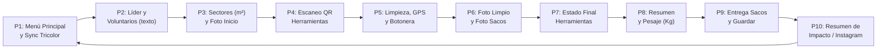
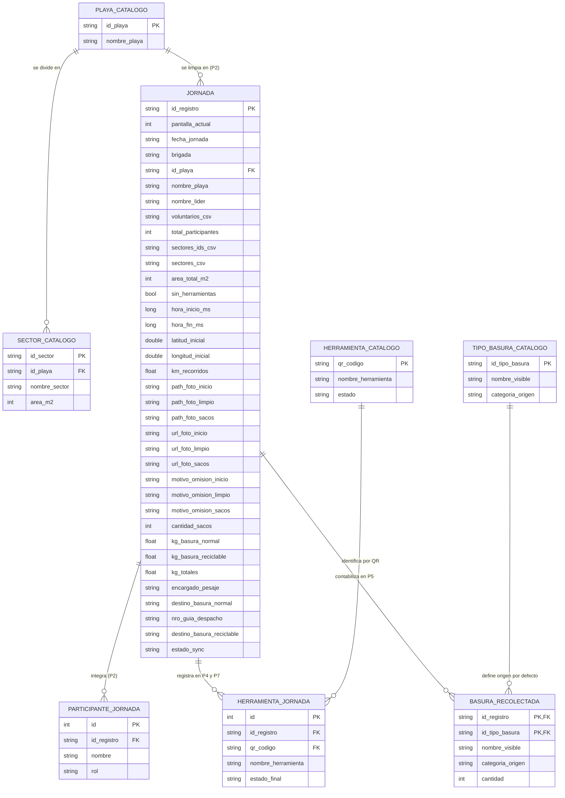

# Product Requirements Document (PRD): App Móvil "Deja tu Playa Limpia" (Logística Verde)

- **Proyecto:** Modelo de Micro-logística Inversa y Trazabilidad Digital (*Logística Verde*)
- **Título de la App:** **Deja tu Playa Limpia** *(Caso Piloto: Playa Grande de Cartagena — $8.000\text{ m}^2$)*
- **Stack Tecnológico ($0 Costo):** Android Studio + Kotlin + Jetpack Compose + Room Database (Offline) + Retrofit 2 / OkHttp 4 + **Supabase (PostgreSQL + RPC + Storage)** $\rightarrow$ Google Sheets
- **Versión:** 4.0 — 31 de octubre de 2026
- **Estado:** Especificación vigente (flujo de **10 pantallas**)

---

## 0. Fuentes Oficiales y Control de Cambios

| Documento | Rol |
| :--- | :--- |
| **`docs/PRD.md`** (este archivo) | **Fuente oficial** de requerimientos funcionales, no funcionales y reglas de negocio. |
| **`docs/ISSUES.md`** | **Fuente oficial** del backlog de implementación. |
| `docs/ARCHITECTURE.md` | Documento derivado: detalle técnico de cómo se implementa este PRD. |
| `docs/GLOSSARY.md` | Documento derivado: vocabulario de negocio y técnico. |
| `logistica-verde-doc/plan_de_trabajo.md` | Insumo de la clienta (v2), **ya incorporado** en esta versión del PRD y en ISSUES. |
| `logistica-verde-doc/Logistica_Verde_Piloto.xlsx` | **Fuera de alcance** hasta que la clienta reformule la planilla (ver §8). |

> En caso de contradicción entre documentos, prevalece **PRD.md**; luego **ISSUES.md**. El PRD de 8 pantallas (PDF, backend Apps Script/Drive) y el entregable académico `.docx` (AppSheet) fueron **eliminados** por obsoletos.

### Cambios v2 → v3

1. **Sin tabla maestra `usuario`:** los nombres del líder y voluntarios se escriben a mano en la Pantalla 2 y viven solo dentro de la jornada (`participante_jornada`).
2. **Nueva Pantalla 10 — Resumen de Impacto** con imagen 1080×1920 para compartir en Instagram.
3. **Seguridad Supabase:** RLS en todas las tablas; la app sincroniza mediante **una única función RPC transaccional**; el bucket de fotos es *solo inserción*; Sheets lee con clave secreta.
4. **Sincronización honesta:** una jornada **nunca** se marca `SINCRONIZADO` si no llegó a Supabase.
5. **GPS en Foreground Service** para medir `km_recorridos` con la pantalla apagada.
6. **Navegación protegida:** reglas del botón Atrás para no reabrir pantallas cerradas.
7. **Room con migraciones explícitas** a partir de la versión 3 (sin borrado destructivo).
8. **Densidad deduplicada:** el área diaria se calcula en Supabase sin contar dos veces un mismo sector.

### Cambios v3 → v4 (31-10-2026, ISSUE-31 a 36)

1. **Playas:** nuevo catálogo `playa_catalogo`; cada sector pertenece a una playa. La playa se elige en P2 y la jornada guarda `id_playa` y `nombre_playa`. P1 ya no muestra un nombre de playa fijo.
2. **Brigadas:** "Cuadrilla" pasa a ser **"Brigada"** (A–D) y "Líder" a **"Líder de brigada"**, también en Room y Supabase (`jornada.brigada`).
3. **Fecha de la jornada:** `fecha_jornada` (hora de Chile) se fija al crear la jornada en P2; es distinta de `fecha_sincronizacion`.
4. **Herramientas:** el QR se mantiene, pero la app muestra solo nombre y número ("Pinza 1"). La pesa sale del inventario. Nueva opción **"Esta brigada no lleva herramientas"**, que salta P7.
5. **Motivo al omitir una foto:** campo de texto obligatorio en la misma pantalla.
6. **Sin "Pantalla N de 10":** cada pantalla muestra solo su título.
7. **Topes y reloj:** límites razonables en app y servidor; la RPC rechaza fechas fuera de rango.
8. **Room v4 y Supabase v4 se reconstruyen desde cero** (datos de prueba); las vistas de reportería se eliminan hasta rediseñar la planilla.

---

## 1. Propósito y Arquitectura General

**Deja tu Playa Limpia (Logística Verde)** es una aplicación móvil Android **100% Offline-First y de costo operativo \$0** para que los líderes de brigada registren en terreno la trazabilidad completa de una jornada de limpieza costera: integrantes de la brigada, superficie intervenida ($\text{m}^2$), préstamo y devolución de herramientas por código QR, fotografías de evidencia, conteo estandarizado de residuos (*Ocean Conservancy* / DIRECTEMAR), distancia recorrida por GPS, pesaje diferenciado, destino final de los sacos y un **resumen de impacto compartible**.

### Arquitectura Híbrida Segura: Room + Supabase + Google Sheets

1. **En Terreno (100% Offline — Room Database):** durante las ~3 horas en la playa, la app lee los catálogos locales y persiste cada paso de las **10 pantallas** en SQLite (**Room**).
2. **En la Nube (Supabase):**
   - **Catálogos maestros** (`sector_catalogo`, `herramienta_catalogo`, `tipo_basura_catalogo`) administrados por el desarrollador; la app solo puede **leerlos**.
   - **Jornadas:** la app sube las fotos al bucket `evidencias-fotos` (solo inserción) y luego llama a la función **`sincronizar_jornada(jsonb)`**, que inserta la jornada con todos sus detalles **en una sola transacción**. La clave pública del APK no tiene ningún otro permiso de escritura.
3. **Reportería (Google Sheets):** un script de Apps Script lee la vista consolidada de Supabase con la **clave secreta** (guardada solo en las *Script Properties* de la planilla) y sirve como *keep-alive* diario del plan gratuito. El diseño final de la planilla queda pendiente de la clienta (§8).

---

## 2. Usuarios y Roles

| Actor | Herramienta | Responsabilidad |
| :--- | :--- | :--- |
| **Coordinadora / Directora** | Google Sheets | Revisa los registros sincronizados, audita las fotos y emite los informes técnicos. |
| **Líder de brigada** (Brigadas A, B, C, D) | App Android (1 teléfono por líder) | Ejecuta el flujo completo de las 10 pantallas y sincroniza. |
| **Encargado de Pesaje** | Punto de acopio (única pesa digital) | Pesa los sacos separados (normal / reciclable) y dicta los valores al líder para la Pantalla 8. Puede ser un participante de la jornada u otra persona. |
| **Desarrollador / Administrador** | Supabase | Mantiene los catálogos maestros y el esquema. |

> Los participantes **no se conocen de antemano** (se inscriben o llegan el mismo día), por eso no existe un padrón de usuarios: por persona se registra **solo el nombre**.

---

## 3. Flujo de Usuario y Requerimientos Funcionales (10 Pantallas)

### Reglas Generales de Navegación (RF-NAV)

* **RF-NAV-1 — Títulos:** cada pantalla muestra solo un título descriptivo (sin "Pantalla N de 10", v4). La numeración P1..P10 se usa solo en la documentación.
* **RF-NAV-2 — Atrás libre hasta P5:** en P2, P3, P4 y en P5 *antes* de presionar `[ Comenzar Limpieza ]`, el botón Atrás del sistema vuelve a la pantalla anterior para corregir datos (P2 → menú, con la jornada guardada `EN_CURSO`).
* **RF-NAV-3 — Atrás bloqueado desde el inicio de la limpieza:** desde que se presiona `[ Comenzar Limpieza ]` y hasta P9, el botón Atrás muestra el diálogo *"¿Salir al menú? La jornada queda guardada y podrás reanudarla."* y **nunca** reabre una pantalla ya cerrada.
* **RF-NAV-4 — Back stack limpio:** al avanzar se elimina del historial la pantalla anterior (`popUpTo`), de modo que no se acumulen pantallas duplicadas.
* **RF-NAV-5 — Reanudación:** si existe una jornada `EN_CURSO`, P1 ofrece `[ Reanudar Jornada ]` con el nombre del paso pendiente y navega exactamente a `pantalla_actual`.

### RF-P1: Pantalla 1 — Menú Principal y Sincronización Inteligente
* **Diseño (31-10-2026):** fondo degradado celeste → blanco, tipografía Nunito, solo modo claro.
* **Encabezado:** logo (imagen pendiente) + **"Deja tu Playa Limpia"** (sin ubicación ni playa: se elige en P2).
* **Tarjeta de portada:** "Playas limpias, comunidades más fuertes / Tu acción hoy, un mejor mañana" sobre una ilustración (pendiente; mientras, degradado).
* **Acción central:** `[ Iniciar jornada ]` o `[ Reanudar jornada ]`; si hay una en curso, debajo se muestra "Líder - Brigada".
* **Barra inferior:** Inicio · **Reportes** (últimas 5 jornadas cerradas, pendientes o sincronizadas → Pantalla 10) · Usuario (atenuado, "próximamente", ISSUE-38).
* **Tarjeta "Estado de sincronización"** según las jornadas `PENDIENTE_SYNC` en Room y la conectividad (punto de color + texto):
  * ⚪ **Gris:** "Sin jornadas pendientes".
  * 🟡 **Amarillo:** "N pendientes · sin internet".
  * 🟢 **Verde:** "N listas para sincronizar". Solo en este estado se puede tocar: sincroniza (§5) y muestra el resultado unos segundos.
  * "Sincronizando…" con indicador de carga mientras envía.
  * Éxito: check animado + sonido + vibración, sin texto. Error: ícono rojo y mensaje simple ~4 s (ej. "Sin conexión estable. Tus jornadas siguen guardadas.").
  * "Servidor en mantención" (gris, sin sincronizar) si Supabase responde PGRST202/205; "N jornada(s) rechazada(s) · revisar en Reportes" (rojo) si hay rechazadas y ninguna pendiente (ISSUE-42).
  * Si una jornada **no** se pudo enviar (red, error del servidor o **APK sin configuración de nube**), permanece `PENDIENTE_SYNC` y el mensaje lo explica. El botón nunca pasa a Gris por una sincronización que no ocurrió.

### RF-P2: Pantalla 2 — Conformación de Brigada (nombres escritos a mano)
* **Card 1 — Líder de brigada:** campo de texto obligatorio con el nombre del líder de brigada (mínimo 3 caracteres), selector de **Brigada A–D** y **selector de playa** (catálogo, obligatorio).
* **Fecha de la jornada:** se registra automáticamente (`fecha_jornada`, hora de Chile) al crear la jornada con el primer participante.
* **Card 2 — Voluntarios:** campo de texto + botón `[ + Agregar ]`; debajo, la lista de voluntarios agregados con opción de eliminar y el contador *"N voluntarios + 1 líder = N+1 integrantes"*.
* **Validaciones:** no se aceptan nombres vacíos ni duplicados (comparación sin distinguir mayúsculas ni espacios extra, incluido el nombre del líder). Se exige **1 líder, al menos 1 voluntario (máximo 60 integrantes) y una playa** para habilitar `[ Siguiente ]`.
* **Persistencia:** cada alta o baja de un participante se guarda de inmediato en Room (RNF-01).

### RF-P3: Pantalla 3 — Selección de Sector(es) y Foto de Inicio
* **Selección múltiple de sectores** desde `sector_catalogo`, **solo de la playa elegida en P2** (cambiar de playa limpia los sectores marcados). Los $\text{m}^2$ se calculan internamente sumando los sectores marcados. Se guardan los **IDs** de los sectores (para reanudar y deduplicar) y sus nombres (para mostrar).
* **Foto de Sector Inicio (Sucio):** captura comprimida a `1280x720 px` JPEG 75%.
* **Omitir foto:** casilla *"Omitir fotografía"*; al marcarla aparece en la misma pantalla un campo de texto **obligatorio** con el motivo (máx. 120 caracteres, sin opciones predefinidas). Se guarda en `motivo_omision_inicio`. *(v4)*
* `[ Siguiente ]` habilitado con ≥ 1 sector y (foto tomada **o** omitida con motivo).

### RF-P4: Pantalla 4 — Herramientas por Código QR
* **Lectura QR** con CameraX + ML Kit (offline) del `qr_codigo` de cada herramienta, con **selector de respaldo** desde `herramienta_catalogo` si el QR no se puede leer.
* La app **nunca muestra el código QR**: solo nombre y número (`nombre_herramienta`, ej. "Pinza 1"). Permite eliminar una herramienta agregada y **bloquea duplicados**.
* Las herramientas `Extraviado` no se pueden usar; las `Dañado` se pueden usar mostrando su estado.
* **"Esta brigada no lleva herramientas"** (v4): casilla que quita las herramientas agregadas, deshabilita el escáner y **salta P7**.
* `[ Siguiente ]` habilitado con ≥ 1 herramienta **o** la casilla marcada.

### RF-P5: Pantalla 5 — Limpieza, GPS (`km_recorridos`) y Botonera
* **Botón superior** `[ Comenzar Limpieza ]` → `[ Finalizar Limpieza ]`. Antes de comenzar, **la botonera está inhabilitada**.
* **Al comenzar:** registra `hora_inicio_ms`, inicia el **servicio de ubicación en primer plano** con la notificación fija *"Limpieza en curso · X,XX km"* (RNF-02), guarda la coordenada inicial y habilita la botonera.
* **Botonera** alimentada desde `tipo_basura_catalogo`: `[ -1 ]` a la izquierda (mínimo 0), nombre + contador al centro, `[ +1 ]` y `[ +10 ]` a la derecha. Cada toque se persiste en `basura_recolectada`.
* **Al finalizar** (con diálogo de confirmación): registra `hora_fin_ms`, detiene el servicio, guarda `km_recorridos` y avanza a P6. Se permite cerrar con 0 residuos.
* Si la app se cierra o el teléfono se reinicia con la limpieza iniciada, al reanudar P5 el servicio se reinicia **conservando** los km acumulados y la hora de inicio.

### RF-P6: Pantalla 6 — Evidencias Finales
* **Foto de Sector Limpio** y **Foto de Sacos Llenos** (720p), cada una con la casilla *"Omitir fotografía"* y su motivo obligatorio (misma regla que P3).
* `[ Siguiente ]` avanza a P7, o a **P8** si la brigada no lleva herramientas.
* `[ Siguiente ]` habilitado cuando cada foto fue tomada u omitida.

### RF-P7: Pantalla 7 — Estado de Devolución de Herramientas
* Lista de las herramientas agregadas en P4 con selector **`Operativo`** *(por defecto: el estado con que salió)* / **`Dañado`** / **`Extraviado`**.
* El estado se aplica también al catálogo **local** de inmediato (para que una herramienta extraviada no se ofrezca en la jornada siguiente) y se envía a Supabase al sincronizar.

### RF-P8: Pantalla 8 — Resumen del Recorrido y Pesaje
* **Resumen automático:** km recorridos, hora inicio – hora término (y duración), nombre del líder, brigada y $\text{m}^2$.
* **Encargado de Pesaje (obligatorio):** desplegable con **los participantes de la jornada** + opción *"Otra persona (escribir nombre)"*.
* **Formulario:** cantidad de sacos (entero), Kg basura normal y Kg basura reciclable (decimales, acepta coma o punto), con **total** y **% de valorización** calculados en vivo.
* **Ley N.° 20.949:** si el peso promedio por saco supera **25 kg**, se bloquea el avance con un mensaje explicativo.
* **Topes (v4):** máximo 100 sacos y 2.500 kg por jornada.
* `[ Siguiente ]` exige encargado, sacos > 0, kg totales > 0 y cumplir la regla anterior; guarda y avanza a P9.

### RF-P9: Pantalla 9 — Entrega de Sacos (Destino Final) y Guardado
* **Card 1 — Basura normal:** `Entregado a camión DIMAO` / `Pendiente de retiro` / `No aplicable`, más el campo opcional **`N° Guía de Despacho`** (solo visible con "Entregado a camión DIMAO").
* **Card 2 — Basura reciclable:** `Entregado a Punto Limpio Municipal` / `Entregado a Reciclador de Base` / `Pendiente de entrega` / `No aplicable`.
* **Coherencia:** si los kg de un tipo son 0, la única opción es `No aplicable`; si son > 0, `No aplicable` no está disponible.
* **`[ Guardar ]`:** valida la jornada completa con las mismas reglas de la RPC (`ValidadorJornada`, ISSUE-42); si algo falla, avisa y no la cierra. Si todo está bien, la marca como `PENDIENTE_SYNC` y avanza a **P10**.
* **Jornadas rechazadas:** si la RPC rechaza una jornada, pasa a `ERROR_SYNC` con el motivo; **nunca se edita** (evita falsificación) y en Reportes solo puede **reintentarse** con los mismos datos. El rechazo queda registrado en Supabase (`jornada_rechazada`).

### RF-P10: Pantalla 10 — Resumen de Impacto (Instagram)
* Funciona **sin internet**: la imagen se genera en el teléfono a partir de los datos de Room.
* **Tarjeta vertical 1080×1920 (9:16)** con:
  * Encabezado: "Deja tu Playa Limpia", nombre de la playa de la jornada, `fecha_jornada` y brigada.
  * Cifras destacadas: **kg recolectados** (normal + reciclable) y **% reciclable**, **N° de personas** (líder + voluntarios, sin nombres), **m² limpiados** (suma de los sectores elegidos en P3), **km recorridos** y **duración**.
  * **Top 3 residuos** según `basura_recolectada` (formato "412 · Colillas de cigarro"; mayor cantidad primero, empate por nombre); se omiten los ítems con cantidad 0.
  * **Sin fotos** (decisión 31-10-2026, Ley 21.719): la tarjeta lleva solo cifras, para no publicar rostros por error.
  * Formatos es-CL: "31 oct 2026", "42,5 kg", "28 %", "2 h 15 min", "1,8 km", "1.200 m²".
  * Pie: hashtag / @cuenta de la organización (texto configurable, por definir con la clienta).
  * *Sin dato educativo en esta versión* (se agregará cuando la clienta entregue datos con fuente verificable).
* **Acciones:**
  * `[ Compartir en Instagram ]` — envía la imagen directo a la app de Instagram (`ACTION_SEND` dirigido), donde el usuario elige Historia, Feed o Mensaje. Si Instagram no está instalado, se abre el selector estándar de Android. (La apertura directa del editor de Historias con `META_APP_ID` queda fuera por ahora.)
  * `[ Guardar en galería ]` (MediaStore, `Pictures/DejaTuPlayaLimpia`) para publicar después. En Android 8 y 9 pide el permiso de almacenamiento solo al tocar el botón.
  * `[ Volver al inicio ]` → P1. El botón Atrás también vuelve a la P1 (nunca a la P9: la jornada ya está cerrada).

---

## 4. Modelo de Datos (Room v4 y Supabase v4)

### Tablas

1. **Catálogos maestros** (solo lectura para la app; semilla local en Room para operar offline desde la instalación):
   - `playa_catalogo` *(v4)*: `id_playa` (PK, `PLAYA-01` = Playa Grande de Cartagena), `nombre_playa`. Las playas y sus m² se definen antes de usarlas; no hay playas sin sectores.
   - `sector_catalogo`: `id_sector` (PK, `SECTOR-01`..`04`), `id_playa` (FK), `nombre_sector`, `area_m2` (2.000 c/u = 8.000 m²).
   - `herramienta_catalogo`: `qr_codigo` (PK, código interno que va en el QR: `INV-02-PINZA-01`..`05`, `INV-03-RASTRILLO-01`..`04`), `nombre_herramienta` (lo único visible: "Pinza 1"…"Rastrillo 4"), `estado` (`Operativo` / `Dañado` / `Extraviado`). La pesa digital no es parte del inventario (v4).
   - `tipo_basura_catalogo`: `id_tipo_basura` (PK), `nombre_visible`, `categoria_origen` (`Recreativa` / `Marítima` / `Higiene`). Ver catálogo en GLOSSARY §2.
2. **`jornada`**: cabecera de la jornada. **Sin** `id_usuario` ni clave foránea a usuarios. `fecha_jornada` (AAAA-MM-DD, hora de Chile) se fija al crearla en P2; `id_playa` + `nombre_playa` identifican la playa; `sin_herramientas` indica que la brigada no llevó herramientas; `motivo_omision_*` es obligatorio para cada foto omitida y nulo si hay foto. `nombre_lider` y `voluntarios_csv` se mantienen como copia de lectura para reportes; la fuente de verdad de los integrantes es `participante_jornada`. `total_participantes = 1 + N voluntarios`. `sectores_ids_csv` guarda los IDs y `sectores_csv` los nombres. Las columnas `pantalla_actual`, `path_foto_*` y `estado_sync` existen **solo en Room**; `fecha_sincronizacion` existe solo en Supabase.
3. **`participante_jornada`** *(nueva)*: `id` (PK autoincremental local), `id_registro` (FK → jornada, `ON DELETE CASCADE`), `nombre`, `rol` (`LIDER` | `VOLUNTARIO`). Única por `(id_registro, nombre normalizado)`.
4. **`herramienta_jornada`**: única por `(id_registro, qr_codigo)`.
5. **`basura_recolectada`**: PK compuesta `(id_registro, id_tipo_basura)`, `cantidad >= 0`.

> **Eliminado en v3:** tabla `usuario` (Room y Supabase), `CatalogoDao` de usuarios y su semilla.
> **v4:** `brigada` → `brigada`; Room v4 y Supabase v4 se reconstruyeron desde cero (`supabase_reset_v4.sql`). Desde la v4, toda migración es explícita.

---

## 5. Sincronización y Seguridad

### 5.1 Flujo de sincronización (por cada jornada `PENDIENTE_SYNC`)
1. **Precondición:** el APK debe tener `SUPABASE_URL` y la clave pública configuradas. Si no las tiene, **no se marca nada** y se informa *"Este APK no tiene configuración de nube"*. Los builds *release* **fallan en la compilación** si faltan.
2. **Fotos:** se sube cada foto existente a `evidencias-fotos/{id_registro}_{n}_{tipo}.jpg` **sin** `x-upsert`. Si Storage responde que el archivo ya existe (reintento), se considera éxito.
3. **Datos:** una sola llamada `POST /rest/v1/rpc/sincronizar_jornada` con un JSON que incluye la cabecera, los participantes, las herramientas (con su estado final), el conteo de basura y las URLs de las fotos.
4. **Resultado:** solo si la RPC responde OK (`INSERTADA` o `YA_EXISTIA`) la jornada pasa a `SINCRONIZADO` en Room. Cualquier error deja la jornada en `PENDIENTE_SYNC` para reintentar.

### 5.2 Función `sincronizar_jornada(p jsonb)`
* `SECURITY DEFINER`, `search_path` fijo; la clave `anon` solo tiene `EXECUTE` sobre ella.
* Ejecuta **todo en una transacción**: inserta `jornada`, `participante_jornada`, `herramienta_jornada`, `basura_recolectada` y actualiza `herramienta_catalogo.estado`.
* **Idempotente e inmutable:** si `id_registro` ya existe, no modifica nada y responde `YA_EXISTIA`. Una jornada sincronizada no se puede sobrescribir desde el APK.
* **Valida** los datos: kg ≥ 0, cantidades ≥ 0, estados y destinos dentro de los valores permitidos, playa existente y sectores **de esa playa**, tipos de basura y QR existentes en los catálogos, al menos 1 líder y 1 voluntario, motivo en cada foto omitida, `sin_herramientas` ⇔ 0 herramientas.
* **Topes (v4):** participantes ≤ 60, cantidad por residuo ≤ 5.000, sacos ≤ 100, kg ≤ 2.500, km ≤ 30, duración ≤ 12 h.
* **Reloj (v4):** `fecha_jornada` entre hoy − 60 días y hoy + 1 (Chile); la hora de inicio no puede estar en el futuro y debe caer el mismo día de `fecha_jornada` o el siguiente.

### 5.3 Permisos (RLS activado en todas las tablas)
| Recurso | `anon` (APK) | Clave secreta (Sheets / admin) |
| :--- | :--- | :--- |
| `playa_catalogo`, `sector_catalogo`, `herramienta_catalogo`, `tipo_basura_catalogo` | `SELECT` | Total |
| `jornada`, `participante_jornada`, `herramienta_jornada`, `basura_recolectada` | Sin acceso directo | Total |
| `rpc/sincronizar_jornada` | `EXECUTE` | — |
| Bucket `evidencias-fotos` (público) | Lectura pública + **solo INSERT** (sin UPDATE ni DELETE) | Total |

### 5.4 Catálogos
* Al abrir P1 con internet se descargan los catálogos y se actualiza Room con `@Upsert`.
* **Regla de no sobrescritura:** el `estado` de una herramienta que aparece en una jornada `EN_CURSO` o `PENDIENTE_SYNC` **no** se reemplaza con el valor del servidor; prevalece el dato local hasta que esa jornada se sincronice.

### 5.5 Densidad deduplicada
* **v4:** las vistas de reportería se eliminaron hasta rediseñar la planilla (ISSUE-30). Cuando se recreen, la densidad debe agruparse por **playa y `fecha_jornada`**.
* *(Diseño v3, referencia)* La vista `vista_densidad_diaria` agrupa por **fecha local (America/Santiago)** las jornadas sincronizadas, une los `sectores_ids` **sin repetir** para obtener el área real del día y calcula la densidad diaria = kg totales del día / área deduplicada.
* La densidad por jornada individual es **referencial** (puede haber sectores compartidos entre brigadas).

---

## 6. Requerimientos No Funcionales (RNF)

1. **RNF-01 — Persistencia paso a paso:** cada avance de pantalla, cada participante agregado o eliminado y cada toque de la botonera se persiste de inmediato en Room.
2. **RNF-02 — GPS eficiente y continuo:** `Foreground Service` con `foregroundServiceType="location"`, `PRIORITY_BALANCED_POWER_ACCURACY` y filtro anti-rebote (> 5 m, precisión ≤ 35 m, saltos ≤ 500 m). Funciona con la pantalla apagada. Objetivo: **< 5 % de batería en 3 horas**. Requiere `FOREGROUND_SERVICE`, `FOREGROUND_SERVICE_LOCATION` y `POST_NOTIFICATIONS` (Android 13+).
3. **RNF-03 — Fotos optimizadas:** `1280x720 px`, JPEG 75 % (~180 KB), guardadas en `filesDir/evidencias/`.
4. **RNF-04 — Sincronización atómica, idempotente y honesta:** ver §5.1 y §5.2.
5. **RNF-05 — Seguridad de datos:** RLS en todas las tablas; la clave del APK no permite leer participantes ni modificar jornadas; la clave secreta nunca va en el APK ni en el repositorio. El *logging* HTTP está activo **solo en debug**.
6. **RNF-06 — Integridad de la base local:** `exportSchema = true` con esquemas versionados en el repositorio. Las migraciones **2 → 3** y **3 → 4** fueron destructivas (solo había datos de prueba); **desde la v4 toda migración es explícita y tiene test** (`MigrationTestHelper`); no se usa `fallbackToDestructiveMigration()`.
7. **RNF-07 — Cumplimiento legal chileno:** Ley N.° 21.719 (las fotos no muestran rostros; los nombres de participantes no son legibles con la clave pública; la tarjeta de Instagram muestra solo la cantidad de voluntarios) y Ley N.° 20.949 (validación de 25 kg por saco, RF-P8).
8. **RNF-08 — Costo \$0 y portabilidad:** cuotas gratuitas de Supabase y Google; *keep-alive* diario desde Sheets; el proyecto compila en cualquier equipo (sin rutas locales en `gradle.properties`) y está bajo control de versiones (git).

---

## 7. Reglas de Negocio (resumen verificable por tests)

| ID | Regla |
| :--- | :--- |
| BR-01 | Una brigada requiere 1 líder de brigada (≥ 3 caracteres) y ≥ 1 voluntario, máximo 60 integrantes; sin nombres vacíos ni duplicados. |
| BR-02 | Solo existen Brigadas A–D. La jornada exige una playa del catálogo. |
| BR-03 | P3 exige ≥ 1 sector de la playa elegida; las fotos de P3 y P6 pueden omitirse solo con motivo escrito. |
| BR-04 | Herramientas `Extraviado` no se pueden agregar; `Dañado` sí, mostrando el estado; sin duplicados por jornada. Con "no lleva herramientas" la jornada tiene 0 herramientas y salta P7. |
| BR-05 | La botonera está bloqueada antes de comenzar; el contador nunca baja de 0. |
| BR-06 | P8 exige encargado de pesaje, 0 < sacos ≤ 100, 0 < kg ≤ 2.500 y promedio ≤ 25 kg/saco. |
| BR-07 | Kg = 0 ⇒ destino `No aplicable`; Kg > 0 ⇒ `No aplicable` prohibido; guía de despacho solo con "Entregado a camión DIMAO". |
| BR-08 | Botón Sincronizar: Gris / Amarillo / Verde según pendientes y red. |
| BR-09 | Una jornada solo pasa a `SINCRONIZADO` si la RPC confirmó la inserción. |
| BR-10 | El catálogo descargado no pisa el estado de herramientas usadas en jornadas no sincronizadas. |
| BR-11 | Atrás libre hasta antes de comenzar la limpieza; luego solo "salir al menú". |
| BR-12 | Top 3 residuos y % reciclable de P10 se calculan con los datos de la jornada (ítems en 0 se excluyen). |
| BR-13 | `fecha_jornada` se fija al crear la jornada (hora de Chile); el servidor la acepta solo entre hoy − 60 días y hoy + 1. |
| BR-14 | Topes: conteo por residuo ≤ 5.000, km ≤ 30 (el GPS no acumula más), duración ≤ 12 h (al finalizar tarde se registra el máximo). |

---

## 8. Fuera de Alcance y Pendientes de la Clienta

* **Planilla Excel / Google Sheets (`TABLERO_KPIs`):** la clienta la reformulará. Luego se diseñará cómo poblarla desde Supabase. Mientras tanto, el conector solo se ajusta para seguir funcionando con el nuevo esquema y la clave secreta.
* **Contenido de la tarjeta de Instagram:** logo, hashtag / @cuenta y datos educativos con fuente verificable.
* **`META_APP_ID` (opcional):** si la clienta registra una app en Meta for Developers, se habilita la apertura directa del editor de Historias.
* Fuera de alcance del piloto: los 1.800 m totales de la playa, el transporte de residuos y la gestión de maquinaria municipal.
