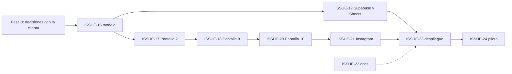

# Plan de Trabajo v2 — "Deja tu Playa Limpia" (feedback de la clienta)

> **✅ Incorporado el 29-10-2026** en `docs/PRD.md` v3.0 y `docs/ISSUES.md` (ISSUE-16 a 30). Este archivo queda como insumo histórico; **el backlog oficial es ISSUES.md**. Diferencias respecto de este plan: la numeración de issues cambió, la migración Room 2→3 es destructiva solo esa vez (después, migraciones explícitas), la app escribe en Supabase solo mediante la RPC `sincronizar_jornada` (sin INSERT/UPDATE directos de `anon`), no hay dato educativo en la tarjeta por ahora y compartir en Instagram es híbrido (App ID opcional).

## Qué cambia

| # | Cambio | Por qué |
|---|---|---|
| A | **Sacar la tabla maestra `usuario`.** El líder escribe a mano los nombres del líder y de los voluntarios, y quedan guardados solo dentro de esa jornada. | Los asistentes no se conocen de antemano: se inscriben o llegan el mismo día. |
| B | **Resumen para Instagram** al cerrar la jornada: una imagen lista para compartir. | Difusión y para que los voluntarios vean el impacto de lo que hicieron. |

---

## Fase 0 — Decisiones con la clienta ✅
- [x] Por persona se pide **solo el nombre**.
- [x] Formato del post: **historia vertical, 1080×1920 (9:16)**, con las **fotos de antes y después**.
- [x] En la imagen de Instagram aparece **solo el N° de voluntarios**, sin nombres.
- [x] Una cuadrilla exige **1 líder y al menos 1 voluntario**.

---

## Fase 1 — Participantes por jornada (en vez de usuarios fijos)

### 1.1 Modelo de datos (Room)
- [ ] **Borrar** `UsuarioEntity`, sus consultas en `CatalogoDao` y sus semillas en `CatalogoSeedData`.
- [ ] **Nueva tabla hija `participante_jornada`** (en vez de seguir usando el CSV, así se puede contar y reportar):
  ```
  participante_jornada
  ├─ id            INTEGER PK autoincrement
  ├─ id_registro   TEXT FK → jornada (ON DELETE CASCADE)
  ├─ nombre        TEXT
  └─ rol           TEXT  ("LIDER" | "VOLUNTARIO")
  ```
- [ ] `JornadaEntity`: **sacar** la clave foránea `id_usuario` y el índice. Se **dejan** `nombre_lider` (copiado ahí para que reportar sea fácil) y `voluntarios_csv` (lo usa la vista de Sheets), y se **agrega** `total_participantes: Int`.
- [ ] Subir la versión de `LogisticaVerdeDatabase` de 2 a 3. Hoy usa `fallbackToDestructiveMigration()`, así que esto borra los datos locales. **Antes de instalar la nueva versión hay que sincronizar las jornadas pendientes.**

### 1.2 Pantalla 2 — Formulario de cuadrilla
- [ ] **Card 1 – Líder:** un campo de texto obligatorio con el nombre (mínimo 3 caracteres) y el selector de Cuadrilla A–D.
- [ ] **Card 2 – Voluntarios:** campo de texto con botón `[ + Agregar ]`. Debajo, la lista de los ya agregados con opción de eliminar, más un contador (`N voluntarios + 1 líder = N+1 integrantes`).
- [ ] Validaciones: no aceptar nombres vacíos ni duplicados (sin importar mayúsculas o espacios). Mínimo 1 líder y 1 voluntario para poder avanzar.
- [ ] Guardar en Room **cada vez que se agrega o elimina alguien**, para que se pueda retomar si el teléfono se apaga (RNF-01).
- [ ] Ajustar `JornadaFlujoViewModel`: cambiar `selectLider` y `toggleVoluntario` por `onNombreLiderChange`, `agregarVoluntario` y `eliminarVoluntario`. Sacar `lideresActivos`, `voluntariosActivos` y `usuariosActivos`.

### 1.3 Pantalla 8 — Encargado de pesaje
- [ ] El menú desplegable debe mostrar a **los participantes de la jornada** en vez de `usuariosActivos`, con la opción "Otra persona (escribir nombre)" por si pesa alguien de la cuadrilla de acopio.

### 1.4 Backend (Supabase y Sheets)
- [ ] `supabase_schema.sql`: `DROP TABLE usuario`, sacar `REFERENCES usuario` y la columna `id_usuario` de `jornada`, crear `participante_jornada` con su política RLS y agregar `total_participantes` a `vista_reporte_jornadas`.
- [ ] `SupabaseApi` y `JornadaSyncRepository`: sacar `getUsuarios()` y agregar `POST /rest/v1/participante_jornada` (con `merge-duplicates`) dentro de la sincronización atómica de cada jornada.
- [ ] `google_sheets_supabase_connector.gs`: cambiar la columna "ID Líder (FK)" por "N° Participantes".

### 1.5 Tests
- [ ] Actualizar `JornadaFlujoBusinessRulesTest` (regla de Pantalla 2 con nombres escritos a mano, sin duplicados), `FakeCatalogoDao` y `FakeJornadaDao`.
- [ ] Agregar un test de sincronización que confirme que los participantes se envían.

---

## Fase 2 — Resumen para Instagram (nueva Pantalla 10)

### 2.1 Flujo
`P9 [Guardar]` → **`P10 Resumen de Impacto`** → `[ Compartir en Instagram ]` / `[ Volver al inicio ]`

- Al guardar en P9 la jornada pasa igual a `PENDIENTE_SYNC`. P10 solo muestra el resultado y **funciona sin internet**: la imagen se genera en el teléfono.
- Desde el menú (P1) también se debe poder volver a abrir el resumen de la última jornada.

### 2.2 Contenido de la tarjeta (historia 1080×1920)
- Encabezado: logo / "Deja tu Playa Limpia", Playa Grande de Cartagena, fecha y cuadrilla.
- Números grandes:
  - 🧹 **kg recolectados** (normal + reciclable) y **% reciclable**
  - 👥 **N voluntarios**
  - 📐 **m² limpiados**
  - 🚶 **km recorridos**, ⏱️ **duración**
- **Top 3 residuos** (de `basura_recolectada`). Ej.: "🚬 412 colillas".
- Dato educativo según el residuo más frecuente (ej. "1 colilla contamina hasta 50 L de agua"). Ojo: estos datos deben tener fuente verificable.
- Foto de **antes / después** (P3 y P6) en pantalla dividida. Si se omitió alguna de las dos, se muestra un fondo con color de marca en su lugar.
- Pie: hashtag o @cuenta de la organización.

### 2.3 Implementación técnica
- [ ] `ResumenImpactoScreen.kt`: vista previa hecha en Compose.
- [ ] `ResumenImpactoGenerator`: dibuja la tarjeta como `Bitmap` (Compose `GraphicsLayer.toImageBitmap()` o `Canvas` nativo) y la guarda en `cacheDir/compartir/resumen_<id>.png`.
- [ ] Compartir por `FileProvider` + `Intent.ACTION_SEND` (`image/png`). Si Instagram está instalado, abrirlo directo (`com.instagram.android`, o `com.instagram.share.ADD_TO_STORY` para historias). Si no, mostrar el selector normal de Android (WhatsApp, Drive, etc.).
- [ ] Agregar `cache-path` en `res/xml/file_paths.xml`.
- [ ] Botón para guardar la imagen en la galería (`MediaStore`) para publicarla después.
- [ ] Test unitario del cálculo de métricas (top 3, % reciclable, duración) separado de la UI.

---

## Fase 3 — Pendientes que ya existían (revisión anterior)

### 3.1 Supabase
- [ ] Ejecutar el `supabase_schema.sql` **ya actualizado** (Fase 1.4).
- [ ] Crear el bucket público `evidencias-fotos` con sus políticas RLS.
- [ ] Revisar los permisos RLS del rol `anon`: SELECT en catálogos, INSERT/UPDATE en las tablas de jornada.

### 3.2 Google Sheets
- [ ] Pegar el `.gs` actualizado en Apps Script y configurar `SUPABASE_URL` y `SUPABASE_PUBLISHABLE_KEY` en Script Properties.
- [ ] Ejecutar `instalarTriggersAutomaticos()` (keep-alive y sincronización).

### 3.3 Build y entorno
- [ ] Ejecutar `./gradlew testDebugUnitTest` y generar el APK desde Android Studio o desde la terminal.
- [ ] (Opcional) Sacar `org.gradle.java.home` de `gradle.properties` porque es una ruta propia de este Mac, o pasarla a la configuración de Gradle del usuario. Así el proyecto se puede compilar en otro equipo o en un CI.
- [ ] `git init` y primer commit, revisando que `local.properties` esté en `.gitignore`.

### 3.4 Consistencia de la UI
- [ ] Los títulos dicen "Paso 1…8" mientras que el PRD habla de Pantallas 2…9. Elegir una numeración y agregar el "Paso 9" (Resumen).

### 3.5 Documentación
- [ ] Actualizar `PRD.md` (RF-P2, RF-P8, nuevo RF-P10, modelo ER sin `usuario` y con `participante_jornada`).
- [ ] Actualizar `ISSUES.md` con los nuevos issues de abajo.
- [ ] Reescribir `ARCHITECTURE.md`: todavía dice "8 pantallas" y Apps Script en vez de Supabase.

### 3.6 Prueba en terreno (piloto)
- [ ] Imprimir los QR de herramientas y probar la lectura a pleno sol.
- [ ] Recorrido completo en modo avión (P1→P10), sincronizar después y comprobar que llega a Sheets.
- [ ] Medir GPS y batería (menos de 5 % en 3 h).
- [ ] Compartir el resumen en una cuenta de Instagram de prueba (historia y feed).

---

## Nuevos issues propuestos

| Issue | Título | Épica | Estimación |
|---|---|---|---|
| ISSUE-16 | Sacar `usuario` y crear `participante_jornada` (Room + migración) | 2 | 0,5 d |
| ISSUE-17 | Pantalla 2: formulario de líder y voluntarios con nombres escritos a mano | 3 | 1 d |
| ISSUE-18 | Pantalla 8: encargado de pesaje desde los participantes | 3 | 0,25 d |
| ISSUE-19 | Supabase, sincronización y Sheets: participantes y nuevo esquema | 4 | 0,75 d |
| ISSUE-20 | Pantalla 10: resumen de impacto (métricas y vista previa) | 3 | 1 d |
| ISSUE-21 | Generar la imagen y compartir en Instagram / galería | 3 | 1 d |
| ISSUE-22 | Actualizar docs (PRD, ISSUES, ARCHITECTURE) | — | 0,5 d |
| ISSUE-23 | Despliegue: Supabase, bucket, Sheets, APK, git | 4 | 0,5 d |
| ISSUE-24 | Prueba piloto en terreno (QA) | — | 1 d |

**Total estimado: ~6,5 días de desarrollo.**

## Orden sugerido


